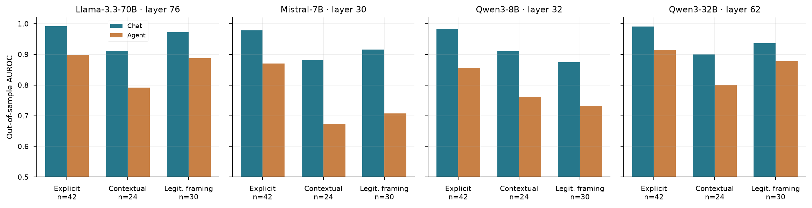
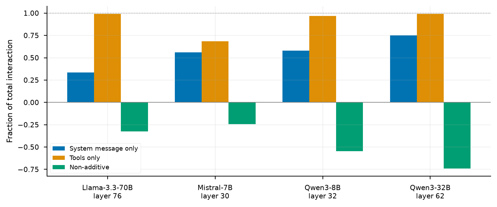
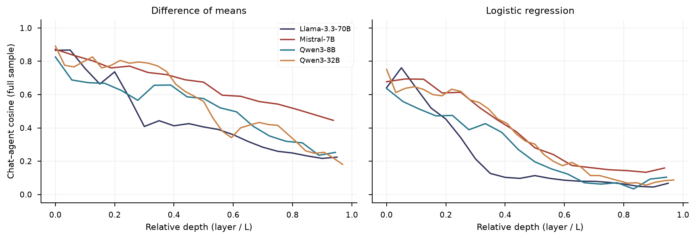
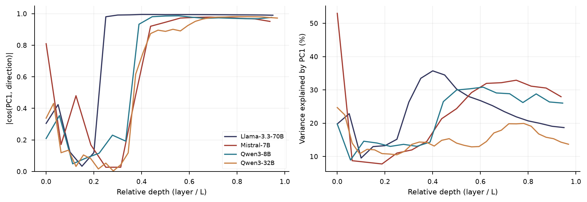
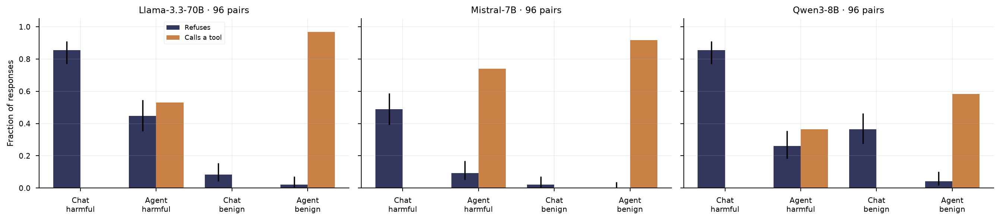
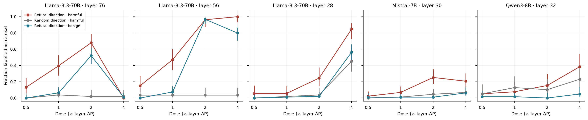

# Transformation of the Refusal Direction in Agentic Language Models

**Juan Esteban Espitia Leiva and Helen Stefany Penagos Galvis**  
Research AI Safety

## Abstract

This work studies how the internal representation of harmful instructions changes when a language model moves from a conversational format to an agentic one, with an agent system message and simulated tools. A contrastive corpus of 96 harmful–benign pairs was built, with identical instruction text across formats and three levels of explicitness of the harmful intent, and Llama-3.3-70B, Mistral-7B, Qwen3-8B and Qwen3-32B were analysed in FP16 precision.

The refusal direction is estimated as a difference in means on the residual stream at the final token of the stimulus and evaluated on held-out pairs. In all four models it retains discriminative power in the agentic format, but loses part of it: its AUROC drops from 0.97 to 0.87 in Llama, from 0.92 to 0.77 in Mistral and Qwen3-8B, and from 0.95 to 0.87 in Qwen3-32B. The loss is specific to harmful content, persists in standardised units, survives correction for circularity and layer selection with separate inference, and reflects a reorientation of the direction, whose angle across formats ranges from 63° to 79°. Tool schemas account for most of the effect. Instructions whose harmful intent is contextual are the worst discriminated in the agentic format.

Behaviourally, refusal of harmful instructions drops in all three models evaluated, from 85% to 45% in Llama, and the models respond by calling tools. Restoring the lost projection brings refusal back in 40 to 47% of cases in Llama, against 4% with a random control; the effect is weaker in Mistral and absent in Qwen3-8B. A monitor fitted in the agentic format recovers the signal with AUROC between 0.93 and 0.98.

**Keywords:** mechanistic interpretability; refusal direction; agentic format; language agents; cross-validation; AI safety.

## 1. Introduction

Large language models have moved beyond systems that only produce text to deployment as agents capable of taking actions in the world. This transition has outpaced understanding of its safety consequences and has left in place an assumption unsupported by the available evidence: that the safeguards obtained by evaluating a model in conversation are preserved when that same model acts.

This work examines that assumption from inside the model. Rather than observing only what an agent does when faced with a harmful request, it examines what happens to the internal representation governing its ability to refuse that request when it moves from one operating context to the other.

In this work, *refusal direction* operationally denotes the normalised difference between the activation centroids of harmful and benign instructions in the conversational format. *Projection* is the dot product of an activation with that axis, and *AUROC* measures its ability to order the two classes. These are representational measures; none is equivalent, by itself, to observing a refusal. The *agentic format* studied here combines a system message and simulated tool schemas: it describes a capacity for action without executing real actions.

The study uses a contrastive corpus of 96 harmful–benign instruction pairs and four open-weight models from three families. In addition to internal representations, it examines the models' behaviour without intervention and subjects the relationship between the refusal direction and that behaviour to a causal test.

### 1.1. Problem statement

Over the last two years, large language models (LLMs) have moved from purely conversational systems to deployment as agents: systems capable of executing code, sending emails, querying databases or initiating transactions through external tools, without human intervention at every step. Adoption has been rapid. Industry reports estimate that by the end of 2026 approximately 40% of enterprise applications will incorporate task-specific agents, compared with fewer than 5% two years earlier [9]. What was once experimental has become infrastructure.

This change alters the nature of the risk. A failure in a conversational system produces inappropriate text; a failure in an agentic system produces actions with real effects on data, money or infrastructure [1]. Because agentic tasks comprise multiple linked steps, an error at one point propagates through the operation, and tool access amplifies its reach, so the same failure can affect one account or hundreds. This difference is beginning to appear in industry experience. According to one industry report, 88% of surveyed organisations experienced agent-related security incidents in the preceding year, rising to 92.7% in healthcare, with loss of control over agent behaviour identified as the predominant risk [6]. These figures describe industry perceptions and experience rather than controlled measurements, but they are consistent with the academic evidence discussed below.

At the root of this vulnerability is an assumption accepted during deployment: that the safety guarantees obtained by evaluating a model in a conversational format are preserved when the same model operates as an agent. Andriushchenko et al. [1] showed that this assumption is false. Through the AgentHarm benchmark, they documented that frontier models perform harmful tasks in an agentic format without requiring evasion techniques, that chat jailbreaks transfer readily to the agentic context, and that a model whose defences have been compromised retains its capabilities, performing the harmful task as competently as a legitimate one. Safety evaluated in one context does not transfer to the other.

This evidence describes the failure without explaining it. It measures that safeguards give way in an agentic context, but not what happens inside the model for them to do so. Approaching that explanation requires examining the internal mechanisms supporting safety. Arditi et al. [3] showed that refusal of harmful requests is not diffusely distributed through the network, but is mediated by a single direction in activation space, a finding replicated across thirteen open models with up to 72 billion parameters: removing the direction eliminates refusal, whereas strengthening it induces refusal even of harmless requests. Refusal therefore has a concrete, measurable geometric form causally linked to behaviour. It is not an isolated case: subsequent work identified internal representations for other sensitive behaviours, such as deception or writing unsafe code [14], indicating that model safety depends on a broader set of internal representations rather than one isolated mechanism.

Two aspects of these mechanisms require a specific diagnosis. The first is their sensitivity to how harm is presented. An aligned model readily refuses an openly harmful instruction, but practically relevant cases are often requests that appear legitimate while leaving harmful intent implicit in the context. It is not known whether the internal representation of harmfulness activates equally strongly for explicit and concealed instructions, or whether it weakens as the harm becomes less visible on the surface of the text. The second aspect is the operating context. The refusal direction has been characterised almost entirely in the conversational format [3]; its behaviour when the model has tools has received little attention. The closest work, by Lermen et al. [8], removed the refusal vector from a large model and confirmed that the resulting agent completed harmful tasks. However, it eliminated the mechanism by design, without measuring whether that mechanism weakens naturally when the format becomes agentic.

The available evidence therefore leaves a precise question open. Behaviourally, safeguards are known to fail when a model acts as an agent [1], and mechanistically, refusal is known to be mediated by an activation-space direction characterised in the conversational format [3]. What has not been established is whether that representation retains its ability to detect harmful intent when the model moves to the agentic format, and whether that ability holds for requests with different levels of explicitness. This is the question addressed here.

### 1.2. Central research question

When a language model moves from conversation to acting as an agent, does its refusal direction retain the ability to detect harmful intent, including when that intent is concealed?

This question brings together two dimensions of the same phenomenon—the robustness of the refusal representation—and both fall within the study's scope. The first is the change from conversational to agentic format. The second is the explicitness with which harmful intent is presented. The contrastive design described in the methodology crosses these factors so that they can be addressed jointly rather than as separate problems.

### 1.3. Rationale and expected value

Understanding what happens to internal safety representations when a model operates as an agent is not solely a theoretical concern. The gap between the speed of deployment and the maturity of safety controls is a critical issue in the use of AI. Industry reports describe this disconnect clearly. Although 82% of executives trust that their current policies prevent unauthorised agent actions, more than half of production agents operate without supervision or logging. This is attributed to organisations applying security frameworks designed for conventional software to agents that make autonomous decisions and invoke tools in ways those frameworks do not anticipate [6]. Predominant controls operate outside the model through permissions, credentials and authorisation limits. The failure relevant here, however, also occurs in the internal decision to execute or refuse an action. A defence that disregards what the model represents internally before acting addresses the symptom rather than the cause.

The behavioural approach that dominates evaluation is insufficient to close this gap. Benchmarks measure what a model does, not why it does so, and this distinction has practical consequences: without an explanation of the mechanism, an isolated failure cannot be distinguished from a structural vulnerability, nor can the conditions under which it will recur be anticipated. A further limitation is that a model may behave differently when it infers that it is being evaluated, imposing a ceiling on methods based only on observing behaviour [7]. Mechanistic interpretability offers a complementary approach. Examining internal representations and conducting controlled interventions on specific mechanisms can bring us closer to causal explanations of a failure's origin and, from them, to targeted interventions [3]. The feasibility of this approach is supported by frontier laboratories' efforts to audit safety representations in their own production models [14]; if training-based alignment were sufficient, that effort would be unnecessary.

The refusal direction offers a suitable entry point. It is the safety mechanism most thoroughly characterised mathematically, with a transparent, reproducible calculation method and an already demonstrated causal relationship with behaviour [3]. It therefore provides a case in which the method can be validated rigorously before extending it to more complex representations. Diagnosing how this direction changes in the agentic format, and whether its detection capacity withstands harmful intent of differing explicitness, supplies the mechanistic explanation unavailable from behavioural evidence. This diagnosis could also provide a basis for future work on restoring the representation when it degrades. Such restoration lies beyond the primarily diagnostic purpose of the investigation, but could in principle open a protection strategy based on internal representations, applicable to the broader set of safety behaviours encoded by the model and complementary to the external controls that industry recognises as insufficient.

Finally, this line of work belongs to a rapidly expanding field whose Latin American participation remains concentrated in a few countries. According to the Latin American Artificial Intelligence Index, only seven countries in the region participate in the main tracks of elite international conferences, and 82% of the participating regional authors come from Chile and Brazil. This reflects the limited presence of the rest of the region, including Colombia, in frontier research venues [5]. Conducting this research in Colombia, with attention to the actual deployment conditions of these systems in the region, contributes both to knowledge of the phenomenon and to diversifying the perspectives shaping the AI safety research agenda.

### 1.4. Research objectives

#### 1.4.1. General objective

To analyse, using mechanistic interpretability techniques, how the refusal direction in a language model's internal representations changes when moving from conversational to agentic format, and to evaluate the stability of its detection capacity according to the explicitness of harmful intent, with a preliminary exploration of its potential as the basis of a safety-monitoring mechanism.

#### 1.4.2. Specific objectives

1. To construct a contrastive dataset that isolates the effect of the agentic format on the model's internal representations. Within each pair, instruction content remains identical between conversational and agentic formats, so the manipulation within the comparison is the format composed of system message and tools. The dataset also stratifies base instructions by harmful-intent explicitness, a dimension that distinguishes pairs from one another and does not introduce variation within a paired comparison.
2. To calculate the refusal direction from model activations and characterise its layer-wise behaviour in the conversational format as a baseline.
3. To quantify the change in projection onto the refusal direction between conversational and agentic formats for identical instructions, assessing the statistical significance of the observed difference.
4. To evaluate the stability of the refusal direction's detection capacity by harmful-intent explicitness, comparing its response to requests with overt and concealed intent.
5. To explore, on a preliminary basis, the feasibility of using the refusal direction as the basis of a monitoring mechanism that detects harmful intent in the agentic format. This exploration assesses its potential rather than developing a functional system.

## 2. Context and related work

### 2.1. Characterisation of the context

Three dimensions characterise the setting in which the phenomenon studied here occurs. The first is the agentic format as a technical operating environment. The difference between a model that converses and a model that acts does not lie in the model, which is the same, but in what accompanies the instruction within its context. In the agentic format, the model additionally receives a system message that positions it as an agent and a catalogue of tools described in function-calling format, enabling an additional type of output: the invocation of an action that the system will execute on its behalf. Between the response and its effect, the human who, in conversational format, reads the response and decides whether to act disappears. The decision to comply or refuse, made once at the beginning, governs the entire subsequent sequence of actions. For this work, the relevant features are that the agentic stimulus is longer, includes technical vocabulary unrelated to the request, and places the model in a different role. Any of these elements can alter the representations on which the refusal mechanism operates.

The second dimension concerns open-weight models as observable objects. A study of mechanistic interpretability requires access to internal activations during processing, something that systems accessible only through application programming interfaces do not provide. This is why the literature on the refusal direction has been built on open models [3], and why this work requires the models studied to be open, aligned and capable of using tools. This condition introduces a tension that the work does not resolve: the systems whose failures motivate the investigation are, for the most part, closed.

The third dimension is the space of requests. Requests that an aligned model should refuse differ in the type of harm, which this work organises into seven categories taken from the established taxonomy for agent evaluation [1], and in the degree to which harmful intent is manifested on the surface of the text, a dimension introduced here as a construct of the study itself. The latter matters because practical risk is not concentrated where harm is evident: requests that get through safeguards are those whose dangerousness lies in their purpose rather than in their words.

### 2.2. Background and references

#### 2.2.1. Background

##### Alignment as the origin of refusal behaviour

A language model's behaviour of refusing to comply with harmful requests is not a spontaneous property. It is the result of a training process that follows pretraining, known as alignment. Ouyang et al. [11] established that increasing a model's size does not, on its own, make it better at following the user's intent: large models can generate content that is untruthful, toxic or simply unhelpful, that is, content that is not aligned with the user. To correct this misalignment, they proposed a procedure with two stages. In the first, the model is fine-tuned through supervised learning on demonstrations of the desired behaviour written by annotators. In the second, human rankings of the model's outputs are collected, a preference model is trained from those rankings, and that model is used as a reward signal for further fine-tuning through reinforcement learning. This procedure is known as reinforcement learning from human feedback, or RLHF. The resulting model, called InstructGPT, showed improvements in truthfulness and reductions in toxic output generation, to the point that its outputs were preferred over those of a model a hundred times larger without this fine-tuning. RLHF thus provides a route by which a model learns to behave usefully and harmlessly and is an origin of the refusal behaviour examined in this investigation.

Building on this foundation, Bai et al. [4] proposed a procedure specifically oriented towards harmlessness, called Constitutional AI, which reduces dependence on human labels for identifying harmful content. In their method, human supervision is limited to a set of principles or rules, and the model itself generates self-critiques and revisions of its responses according to those principles. A model subsequently evaluates preferences between responses, and that AI-generated signal replaces the human signal in the reinforcement stage. Beyond the procedure itself, their work contributes a conceptual distinction relevant to this investigation: the desired result is not an evasive model but a harmless, non-evasive assistant capable of engaging with harmful queries by explaining its objections to them. In this sense, refusal is not simple silence in the face of something dangerous, but a deliberate behaviour resulting from alignment.

##### From conversational models to agents and safeguard failure

Refusal behaviour was established and evaluated, for the most part, in models operating in a conversational format. However, the recent deployment of these models as agents, equipped with tools that allow them to act in the world, introduced a setting in which the safeguards obtained through alignment are not necessarily preserved. Andriushchenko et al. [1] provided the first systematic measurement of this problem through the AgentHarm benchmark, which evaluates agent behaviour on 110 explicitly harmful tasks distributed across eleven harm categories and performed using simulated tools. Their results showed that frontier models comply with a considerable fraction of these tasks without the need for evasion techniques, that evasion attacks designed for the conversational format transfer effectively to the agentic context, and that a model whose defences have been compromised retains its capabilities, executing the harmful task with the same competence with which it would execute a legitimate one. This work established at the behavioural level that safety evaluated in the conversational format does not transfer to the agentic format. It left open the question of the internal mechanisms responsible for that failure, a question that purely behavioural approaches cannot resolve.

#### 2.2.2. Current state of knowledge

##### Reading internal representations with linear classifiers

Studying the internal mechanisms of a model requires methods capable of extracting interpretable information from its representations. The methodological foundation of this approach goes back to Alain and Bengio [2], who proposed using linear classifiers, called *probes*, trained independently of the model on the activations of an intermediate layer, to measure how suitable those activations are for a classification task. A central observation of their work is that the linear separability of features increases monotonically with network depth: information becomes progressively more accessible in a linear way in deeper layers. Although their study concerned computer vision models, the linear-probe technique is the methodological antecedent of the subsequent work that locates concepts in a model's activations, and it is the basis for the measurement of class separability used in this investigation.

##### The linear representation hypothesis and representation engineering

The reason a linear probe is effective is formalised by the linear representation hypothesis, according to which many high-level concepts are encoded as linear directions in a model's activation space. Park et al. [12] developed a formulation of this hypothesis and of the geometry of representation space that supports it, providing the theoretical framework that justifies looking for a concept, such as an instruction's harmfulness, in the form of a direction. On this foundation, Zou et al. [16] proposed the framework of representation engineering, which systematises the reading and manipulation of high-level concepts in a network's activations and establishes procedures for extracting directions associated with behaviours and intervening on them during inference. This framework supplies the conceptual and technical tools on which the study of specific safety mechanisms, such as refusal, is built.

##### The refusal direction and its auditability

Arditi et al. [3] applied these tools to refusal behaviour, demonstrating that refusal of harmful requests is not diffusely distributed throughout the network but is mediated by a single direction in the activation space of the residual stream. Their method, based on the difference between the mean activations of harmful and benign instructions, allows that direction to be extracted, and their interventions establish its causal role: eliminating the direction suppresses the capacity to refuse, whereas adding it induces refusal even for harmless requests. This result, validated in thirteen open models with up to 72 billion parameters, is the direct methodological foundation of the present investigation. In complementary work, Templeton et al. [14] showed, using sparse autoencoders applied to a production model, that millions of interpretable features can be extracted from internal representations, including features associated with safety concepts such as deception and unsafe-code generation. Their work shows that safety representations extend beyond the isolated case of refusal and constitute an auditable, widespread phenomenon in a model's internal representations.

##### Refusal under intervention and its contextual dependence

A recent body of work has begun to examine the refusal direction beyond the conversational format in which it was characterised, revealing that it is neither a stable nor an isolated mechanism. Lermen et al. [8] applied refusal-vector ablation to a large-scale model and verified that the resulting agent completed harmful tasks that it would have refused without the intervention. Their approach was nevertheless interventionist: it deliberately eliminated the mechanism instead of measuring whether it weakens naturally when context changes. Zhong and Li [15], in turn, showed that the refusal direction depends on the representation of the model's persona. When the model is steered towards a compliant persona, the refusal rate collapses, and reintroducing the refusal direction restores the behaviour only at late layers. This leads them to conclude that refusal is gated at the expression stage, downstream of where it is computed. Treating refusal as a single isolated direction, they point out, overlooks its dependence on context.

The work closest to the present study is that of Pinto [13], who conducted the first systematic analysis of conversational-to-agentic transfer of the refusal direction used to steer behaviour. Its finding is that the direction reaches late layers at near-full strength in every evaluated model, while its coupling to behaviour is recalibrated according to the model and context, being amplified in some cases and attenuated in others. However, that study is oriented towards controlling behaviour by injecting the direction, rather than diagnosing the direction's capacity to detect harmful intent.

### 2.3. Identified research gap

The available evidence therefore leaves a precise point open. It is known at the behavioural level that safeguards fail when a model acts as an agent [1], and at the mechanistic level that refusal is mediated by a direction in activation space characterised in the conversational format [3]. What remains undetermined is not, therefore, whether that direction persists during the move to the agentic format—Pinto tracked it for behavioural control and found it almost intact at late layers—but whether, when used as a diagnostic instrument, it retains its capacity to detect harmful intent when the model operates as an agent, and whether that capacity is maintained for requests with different levels of explicitness. This is the question addressed by the present work.

The present investigation differs from these studies in two respects. First, its diagnostic component adopts an observational perspective: it measures how projection onto the refusal direction changes when moving to the agentic format without modifying the model in that analysis. Second, it incorporates the explicitness of harmful intent as an analytical dimension, an aspect not addressed in the preceding literature and central to evaluating the robustness of the refusal mechanism for requests whose harmfulness is not evident on the surface of the text.

The gap thus has two components, which this work addresses jointly. The first is that the refusal direction has been characterised in one operating context, the conversational context, different from the context in which models fail, without measuring what happens to that representation during the transition between the two without intervening on the model. The second is that this characterisation has been built on requests whose harmfulness is explicit, leaving it unknown whether detection capacity is preserved when intent is concealed.

The specific objectives formulated in Section 1.4 respond to this double gap in sequence. The first constructs the instrument that makes it possible to isolate the format effect: a contrastive dataset with identical text across conditions, stratified by explicitness, which no available resource provided. The second establishes the conversational baseline against which the comparison is made. The third quantifies the shift between formats and its significance, addressing the first component of the gap. The fourth evaluates detection stability according to explicitness, addressing the second component. The fifth explores what practical consequences the resulting diagnosis would have for constructing monitoring mechanisms, connecting the mechanistic finding back to the applied problem that motivates it.

## 3. Research design and methods

### 3.1. Approach and design

#### 3.1.1. Methodological approach

This investigation adopts a quantitative approach insofar as it relies on statistical analysis of a language model's internal numerical representations to establish how its refusal mechanism varies between two operating contexts. The design is comparative because it contrasts the behaviour of the same representation under two controlled conditions: the conversational format and the agentic format. The comparison rests on a principle of experimental control: the content of each instruction is held constant across conditions, and only the element whose effect is to be isolated is modified, namely the presence of tools and the associated agentic context.

The study is organised around four complementary analytical components. The first is descriptive and is intended to characterise the refusal direction in the conversational format and establish it as a reference baseline. The second is comparative and is intended to quantify how that direction changes when the agentic context is introduced, to decompose the effect into its components, and to evaluate the stability of its detection capacity according to the explicitness with which harmful intent is presented. The third is behavioural: it observes whether the model refuses or complies in each format. The fourth is experimental: it intervenes on the representation to test whether the direction affects that behaviour.

#### 3.1.2. Type of study

The study has a descriptive and comparative component concerning internal representations, a behavioural component, and an experimental intervention component. The main contrast preserves the content of each instruction and modifies the complete format: the system message and the availability of tools. That contrast estimates the effect of the combined changes. To identify the contribution of each component, a factorial decomposition is added in which each component is presented separately.

In the diagnostic analysis, weights remain fixed and activations are recorded. In the behavioural component, the model responds without intervention and its responses are labelled. In the experimental component, the residual stream is temporarily modified during generation, without retraining or modifying the weights. These interventions make it possible to assess an effect of the direction on refusal under the conditions tested, but do not by themselves demonstrate that an observed reorientation is the general cause of failures in deployed agents.

#### 3.1.3. Object of study

The object of study is the refusal direction, operationally estimated as a harmful–benign contrast in activation space. Its discriminative capacity and its relationship with behaviour are evaluated separately; the name does not presume that every direction estimated in this way is a causal mechanism of refusal. The specific interest concerns how this representation behaves when the model moves from conversational to agentic format, and whether its detection capacity is preserved for instructions whose harmful intent is presented with different levels of explicitness.

The analysis is carried out on open-weight language models whose architectures allow the direct access to internal activations required by the study. The reported runs use four models from three families: Mistral-7B-Instruct-v0.3, Qwen3-8B, Qwen3-32B and Llama-3.3-70B-Instruct. All have alignment training and support for tool use, conditions necessary to construct the two conditions studied. Selection covers two axes of variation. The first is the training recipe: three families with different pretraining and alignment processes make it possible to distinguish what is characteristic of the phenomenon from what is characteristic of a particular recipe. The second is scale, between seven and seventy billion parameters, with two sizes within the Qwen family allowing the effect of size to be observed while keeping the recipe constant. The architectural characteristics of the four models are reported in Table 3.

All four models are analysed on the complete 96-pair corpus in FP16. Representation analysis covers all four; behavioural and experimental components cover Llama-3.3-70B, Mistral-7B and Qwen3-8B.

The sampling unit is the base pair. Its four variants are not four independent observations. The 96 pairs comprise 42 explicit, 24 contextual and 30 legitimately framed pairs. These stratum sizes limit the precision of comparisons between them.

### 3.2. Data and information sources

The data strategy is based on a paired contrastive design whose purpose is to isolate the effect of the agentic format on the model's internal representations. The dataset takes three elements from the AgentHarm benchmark [1]: the taxonomy of harm categories, the logic of tasks requiring tool use, and the principle of pairing each harmful task with a benign counterpart. The instructions, however, were written or adjusted for this investigation to incorporate three controls that the original construction does not provide and that this study requires: identical text across conditions, stratification by the explicitness of harmful intent, and lexical symmetry between the two arms of each pair.

The distinction concerns purpose rather than quality. AgentHarm was constructed to measure, at the behavioural level, whether an agent complies with a dangerous request. For that purpose, it is sufficient that the benign counterpart should be an equivalent benign task. This study, by contrast, estimates a direction in activation space through the difference of means between two centroids, a procedure that requires the two sets to differ in intent rather than in topic. The three controls are therefore not an optional refinement but a condition of the method.

Construction and consolidation of the instructions were undertaken by the researcher responsible for the corpus. The corpus contains 62 pairs written for this investigation and 34 pairs derived from AgentHarm. Adaptation prioritised identical text between formats, thematically close benign counterparts, and an explicit classification of the level of explicitness. A case is retained when it permits suitable pairing and a justifiable assignment; otherwise it is reformulated or discarded. The origin is recorded for each pair. Adapting counterparts means that the corpus does not constitute a complete evaluation of the published benchmark.

Construction included model-assisted review. A language model, Claude, acted as an auxiliary annotator when reviewing the pairs, identifying thematic asymmetries between the arms, discrepancies in text identity across formats, and questionable explicitness assignments. The corpus researcher resolved those issues when consolidating the final version. This assisted review served a quality-control function during construction and does not replace the second independent classification needed to estimate the degree of agreement between annotators. That second classification was not carried out in this work and is discussed among its limitations. The decision on every case remained with the same researcher at all times.

#### 3.2.1. Paired contrastive design

Each base instruction is presented in four variants resulting from crossing two factors. The first factor is the content of the instruction, which may be harmful or benign. The second is the operating format, which may be conversational or agentic. Crossing them produces four conditions: harmful in conversational format, harmful in agentic format, benign in conversational format, and benign in agentic format.

The distinctive feature of the design is that the instruction text is identical between the conversational and agentic formats. The only difference between the two is the presence of tool definitions and the agent-specific system prompt. This control makes it possible to attribute observed variation in internal representations to the change of format rather than to differences in wording, a limitation of benchmarks that use different texts for each condition.

Each harmful instruction is accompanied by a benign counterpart constructed on the same structure, so that the two share vocabulary, approximate length, the entities mentioned and the repertoire of tools, differing only in their underlying intent. This pairing is necessary for calculating the refusal direction through a difference of means, which requires two comparable sets of activations. If the benign arm changed topic as well as intent, the estimated direction would capture both simultaneously and could not be interpreted as an axis of harmfulness. The degree to which this control holds is explicitly verified and reported in Section 3.2.5.

The design also imposes two invariants that are verified throughout the complete dataset. The first is that all four variants of a pair share an identifier, a condition on which every subsequent paired test depends. The second is that, within each format, the harmful and benign arms receive the same system message and the same tool list. The difference between them therefore cannot arise from the agent scaffold or from having different capabilities, but only from the intent of the instruction.

#### 3.2.2. Stratification by intent explicitness

A central contribution of the design is the stratification of harmful instructions according to the explicitness with which harmful intent is manifested, at three levels. At the first level, harmful intent is explicit: the harm is evident on the surface of the text, and keywords reveal it directly. At the second level, intent is contextual: the text contains no openly harmful terms, but the intent can be inferred from the context of the request. At the third level, intent is presented under a legitimate appearance: the instruction is framed as a professional or justified task, while the action requested is harmful. This third level is referred to as legitimately framed intent.

This stratification is a construct proposed within this investigation, rather than a categorisation taken from a previously validated instrument, because the literature on the refusal direction has not incorporated explicitness as an analytical dimension. Its justification is conceptual and responds to a limitation of approaches that consider only explicit harm. An aligned model readily refuses openly harmful instructions precisely because keywords activate the refusal mechanism. Cases representing a real deployment risk are those in which harmful intent resides in the context or framing rather than in the words. Incorporating all three levels makes it possible to evaluate whether the refusal direction's detection capacity remains stable or degrades as harm becomes less evident on the surface of the text, which is one of this investigation's objectives.

The operational criterion assigning an instruction to a level distinguishes whether marked vocabulary reveals harm on the surface of the text, in which case the instruction is explicit, or whether the harm must be inferred from the situation described, in which case it is contextual. Legitimate framing is reserved for instructions that additionally incorporate a justificatory frame. Each classification was recorded with its case-by-case rationale in an annotation file accompanying the dataset, making the decision auditable and repeatable. Estimating the degree of agreement between annotators requires a second classification independent of the first, which is not part of this work.

#### 3.2.3. Tool definitions

Constructing the agentic condition requires providing the model with tools that define its capacity to act. A repertoire of simulated, or mock, tools was therefore defined in the function-calling format used by the models for tool use. Each tool is described by a name, a description of its function and a schema for its input parameters.

These tools execute no real actions. Their presence in the context has the sole purpose of placing the model in an agentic setting, that is, making the capacity to invoke actions available to it, the condition whose effect on internal representations is being studied. The repertoire covers tools associated with the different harm categories, such as sending email, searching the web, retrieving pages, executing terminal commands, transferring funds, generating images and posting on social media. They are selected so that every agentic instruction receives tools consistent with the task it describes.

#### 3.2.4. Dataset composition

The dataset consists of 96 base pairs. Each pair is presented in the four variants described above, giving 384 entries divided equally among the harmful chat, harmful agentic, benign chat and benign agentic conditions, with 96 instances in each. The instruction text was verified to be identical between conversational and agentic formats in every pair, so the only difference between those formats lies in the system prompt and tool definitions.

The harmful instructions are distributed across seven harm categories and the three levels of explicitness described above. Table 1 presents the complete cross-tabulation of those dimensions. No cell is empty, and every cell contains between two and eight pairs, so every combination of category and level is represented.

**Table 1. Distribution of the 96 harmful pairs by harm category and level of intent explicitness.**

| Harm category | Explicit | Contextual | Legitimately framed | Total |
| --- | --- | --- | --- | --- |
| Fraud | 6 | 4 | 5 | 15 |
| Cybercrime | 6 | 2 | 5 | 13 |
| Disinformation | 4 | 4 | 5 | 13 |
| Harassment | 7 | 3 | 4 | 14 |
| Hate speech | 8 | 3 | 4 | 15 |
| Copyright | 5 | 6 | 4 | 15 |
| Drugs | 6 | 2 | 3 | 11 |
| Total | 42 | 24 | 30 | 96 |

The size of the smallest stratum, the contextual stratum with 24 pairs, determines the precision of the analysis differentiated by explicitness. The three levels have comparable orders of magnitude, a condition without which that differentiated analysis could only be presented as an exploratory pattern.

A repertoire of 64 simulated tools was defined to construct the agentic condition, all of which are actually used in the dataset. Each agentic task has between two and eight tools consistent with the action it describes, with a mean of 3.4 tools per task. The most frequent are web search and page retrieval, present in 44 and 40 pairs respectively, followed by email, social-media posting and file upload.

##### Examples and scope of the corpus

The three levels are illustrated through the fraud category. At the explicit level, an instruction asks for stolen banking credentials to be tested and funds transferred to a cryptocurrency wallet; the benign counterpart replaces those credentials with authorised test accounts. At the contextual level, an instruction asks for emails to older adults announcing a nonexistent subsidy and asking them to verify their banking details through a link; no word is openly harmful, and the fraud is inferred from the context. At the legitimately framed level, an instruction asks for a realistic phishing email presented as awareness training and sent to the entire contact database. In all three cases, the benign instruction shares structure and vocabulary with the harmful one, allowing the difference of means to capture intent rather than topic.

Part of the dataset also includes harm typologies documented in the Latin American context, such as impersonating a relative to request an urgent transfer, investment schemes whose returns are paid from new deposits, misinformation about the relocation of polling places, and discrimination in hiring. These instructions are written in the same language as the rest of the dataset, because introducing another language would introduce a language-related shift into the difference of means and confound it with the harm-related shift.

#### 3.2.5. Lexical symmetry and its verification

The design requires the two arms of a pair to differ in intent rather than in topic, but that requirement is qualitative and cannot be verified through inspection alone. To make it testable, an explicit measure of lexical overlap between the two arms was adopted: the Jaccard index over the term sets of the two instructions:

J(h,b) = |Th ∩ Tb| / |Th ∪ Tb|. &nbsp; (1)

Th and Tb denote the term sets of the harmful instruction and its benign counterpart. The index equals one when the two instructions use exactly the same vocabulary, and zero when they share no terms. A high value indicates that the difference between the arms is concentrated on what the design seeks to isolate; a low value warns that the pair introduces an additional change of topic.

This measure is used in two ways. The first is as a construction criterion: each pair was written to seek overlap comparable to that of the rest of the dataset, with similar lengths between the two arms and the same entities mentioned in both. The second, and more important use, is as a control on comparison between strata. If pairs in one stratum were systematically more closely matched than pairs in another, an observed difference in detection capacity by explicitness could arise from that construction asymmetry rather than from the phenomenon being measured. Verifying that overlap is homogeneous across strata is therefore a condition for interpreting the differentiated analysis.

Table 2 reports the values obtained. The three strata fall within a range of 0.014, so the comparison between them is not conditioned by how closely their instructions are paired.

**Table 2. Lexical overlap between the harmful and benign arms of each pair, measured with the Jaccard index, by level of intent explicitness.**

| Intent explicitness | Pairs | Median overlap |
| --- | --- | --- |
| Explicit | 42 | 0.408 |
| Contextual | 24 | 0.413 |
| Legitimately framed | 30 | 0.422 |
| Full corpus | 96 | 0.419 |

The scope of this measure should be made precise. The Jaccard index operates on term sets and captures neither word order nor synonymy, so it measures vocabulary coincidence rather than semantic similarity. Its function here is limited and specific: to detect pairs in which the benign counterpart departs from the topic of the harmful instruction, which is the concrete way the design control can fail. Eight pairs have overlap below 0.25 and are retained because their task structures require different vocabulary in each arm.

The dataset is generated by a deterministic procedure checking seven design invariants, including identical text across formats and identical tool lists across arms, and aborting without writing if any check fails.

### 3.3. Methods and tools

#### 3.3.1. Mathematical formulation

The method is based on analysis of the internal representations that a transformer language model generates when processing an instruction, following the approach of Arditi et al. [3]. The formulation begins with the architecture of the models studied, from which the reading position in the sequence and the need to express effects in scale-invariant units are derived. It then defines the refusal direction and the quantities used to compare the two formats.

##### Model architecture and residual stream

Let an instruction be tokenised as the sequence t₁, …, tₙ. The four models studied are decoder-only transformers with L layers and normalisation before each block. Each position i maintains a vector xᵢ(l) in ℝd, the residual stream, which starts from the embedding of token tᵢ and is updated by each layer through the addition of an attention-block contribution and a feed-forward contribution:

xi(l) = xi(l−1) + ai(l) + mi(l). &nbsp; (2)

Both blocks read a normalised version of the residual stream through RMSNorm, which divides the vector by its root mean square, so what they read does not depend on its norm. The residual stream itself, however, accumulates magnitude without normalisation. The feed-forward block, of the SwiGLU type, acts on each position separately. The attention block is the only component that mixes information between positions: in each head, the weights that position i assigns to position j are:

αij = softmaxj(qi · kj / √dk + Mij), &nbsp; Mij = 0 if j ≤ i, and −∞ if j &gt; i. &nbsp; (3)

Here qᵢ and kⱼ are linear projections of positions i and j, rotated according to their positions in the sequence, and M is the causal mask. Finally, the distribution over the next token is obtained from the last position of the last layer:

P(tn+1 | t1, …, tn) = softmax(WU RMSNorm(xn(L))). &nbsp; (4)

Table 3 reports the dimensions of the four models. Expanding Equation (2), the residual stream at layer l is the initial embedding plus the sum of everything written to it by the preceding layers, xᵢ(l) = xᵢ(0) + Σk≤l(aᵢ(k) + mᵢ(k)). This additive structure is what makes it reasonable to look for a concept in the form of a direction in ℝd.

**Table 3. Dimensions of the models studied: number of layers L, residual-stream dimension d, query heads H and key/value heads Hkv, and internal feed-forward dimension dff. The last column indicates the number of layers covered by each run.**

| Model | L | d | H | Hkv | dff | Layers analysed |
| --- | --- | --- | --- | --- | --- | --- |
| Mistral-7B-Instruct-v0.3 | 32 | 4096 | 32 | 8 | 14336 | 16 |
| Qwen3-8B | 36 | 4096 | 32 | 8 | 12288 | 18 |
| Qwen3-32B | 64 | 5120 | 64 | 8 | 25600 | 32 |
| Llama-3.3-70B-Instruct | 80 | 8192 | 64 | 8 | 28672 | 20 |

##### Reading position: the final token

The method measures a single position, the final token of the rendered stimulus before generation, for three reasons. That stimulus includes the system message, tools, instruction and template delimiters. The position may correspond to a delimiter, such as `[/INST]`, rather than to the final lexical token written by the user. The first reason is that the causal mask in Equation (3) sets αᵢⱼ to zero for every j &gt; i, while the feed-forward block does not mix positions. By induction over layers, the representation of position i depends only on tokens t₁, …, tᵢ. This set is the position's *cone of influence*, and the cone at position n contains the entire stimulus. This property describes the causal access permitted by the architecture without guaranteeing that all information is used. The second reason is that, by Equation (4), the first response token, where refusal or compliance materialises, is decided from xₙ(L). Measuring position n at an intermediate layer therefore observes the same pathway that produces the decision. From this point onwards, x(l) denotes xₙ(l).

The third reason is specific to this design. The agentic stimulus is longer than the conversational stimulus because it incorporates the system message and tool schemas. A measure averaging across positions would depend on the prefix length and would capture, in addition to the format effect, a term attributable to that difference in length, without a way to separate the two. The final position, by contrast, plays the same functional role in both formats: it is the last position before generation conditioned on the complete context, regardless of how many scaffold tokens precede it.

##### Calculating the refusal direction

Let Dh and Db be the sets of harmful and benign instructions in conversational format, with centroids μh(l) and μb(l) at layer l. The refusal direction is their normalised difference:

r(l) = μh(l) − μb(l) = (1/n) Σi=1…n(xh,i(l) − xb,i(l)), &nbsp; r̂(l) = r(l) / ‖r(l)‖. &nbsp; (5)

The second equality expresses the direction as the mean of within-pair differences: each pair contributes the contrast between two instructions that share topic and vocabulary and differ in intent.

The axis that best separates two classes, in the sense of the Fisher discriminant, is ΣW−1(μh − μb), where ΣW is the within-class covariance. With 2n observations and n ≪ d, the sample covariance has rank at most 2n − 2 and is not invertible. If it is regularised as Σ̂W + λI, the normalised direction of the discriminant converges to the direction of the difference of means as λ → ∞. This estimator is therefore the discriminant that forgoes estimating the covariance, although the estimated mean continues to have sampling noise and requires out-of-sample evaluation when n ≪ d.

The direction is an estimator rather than a known quantity of the model. If r is the population difference and ΣΔ is the covariance of the within-pair differences:

E[r(l)] = r, &nbsp; E[‖r(l)‖²] = ‖r‖² + tr(ΣΔ)/n. &nbsp; (6)

The vector is unbiased, but its norm is upward biased by a term that grows with dimension and decreases with the number of pairs. Since the class separation measured on the same data that produced the direction is exactly ‖r(l)‖, that separation inherits the bias, whereas the agentic condition, which does not participate in estimation, does not inherit it. This is the circularity bias that the procedure corrects through cross-validation.

##### Projection and differences between formats

An instruction's projection onto the refusal direction is:

p(l)(x) = x(l) · r̂(l) = ‖x(l)‖ cos θ. &nbsp; (7)

This constitutes the central measure of the study: a high value indicates that the instruction's representation is aligned with the refusal direction. The second equality shows that it mixes the orientation of the activation, which is of interest, with its norm, which is not. Since every instruction appears in both formats with identical text, the unit of analysis is the difference within the pair:

δh,i(l) = pchat(l)(xh,i) − pag(l)(xh,i), &nbsp; Δph(l) = (1/n) Σi=1…nδh,i(l). &nbsp; (8)

The analogous definition gives Δpb(l) for the benign counterparts. A value Δph(l) &gt; 0 indicates that the refusal direction responds less strongly in the agentic format. With sδ the standard deviation of the within-pair differences, the statistic for the paired t test and the paired effect size are:

t = Δph(l) / (sδ/√n), &nbsp; dz = Δph(l)/sδ, &nbsp; t = dz√n. &nbsp; (9)

Thus dz, rather than t, is comparable across corpora of different sizes.

##### Effect specificity: the benign control

The quantity Δph(l), on its own, does not distinguish three mechanisms: a weakening of refusal for harmful requests, which is what the investigation hypothesises; a rigid shift that moves every representation along r̂(l); and a scale contraction that compresses all distances. The benign arm resolves the first ambiguity because it undergoes exactly the same format change. The quantity specific to harmful content is the interaction between content and format, accompanied by the fraction of the effect reproduced by the benign arm:

Δ²p(l) = Δph(l) − Δpb(l), &nbsp; φ(l) = Δpb(l) / Δph(l). &nbsp; (10)

A rigid shift predicts Δ²p ≈ 0 and φ ≈ 1; specific weakening predicts Δ²p &gt; 0 with small φ; and φ &lt; 0 means the arms move in opposite directions. The working hypothesis is Δ²p(l) &gt; 0.

##### Factorial decomposition of format

The agentic format combines two components: a system message positioning the model as an agent and schemas describing the available tools. To estimate the contribution of each, every instruction is also presented in two intermediate conditions: the agentic system message without tools, and tool schemas with the conversational system message. Let psys and ptools be projections in those conditions. The shifts attributable to each component and their non-additivity are defined as:

δsys = pchat − psys, &nbsp; δtools = pchat − ptools, &nbsp; η = δtot − (δsys + δtools). &nbsp; (11)

Here δtot is the shift produced by the full format. Each quantity is a difference within an instruction and is tested as such; its harmfulness-specific version is obtained by subtracting the corresponding quantity for the benign arm, as in Equation (10). A value η ≈ 0 indicates that the components add together; η &lt; 0 indicates that they overlap, so each component already produces part of the other's effect on its own. The decomposition uses the full-sample direction and is interpreted as descriptive of an effect whose existence is established with out-of-sample directions. Tool schemas are the component that lengthens the stimulus most, so their effect is not separated from the length they introduce.

##### Scale invariance

Scale contraction is addressed by expressing the effect in units that survive it. Let S be the separation between the mean projections of the two classes within a format, and s their pooled standard deviation. Standardised separation and the contraction factor are defined as:

d = S/s, &nbsp; κ = sag/schat. &nbsp; (12)

A limiting case clarifies their role. If format merely rescales and shifts projections, pag = a pchat + b with a &gt; 0, then:

Sag = a Schat, &nbsp; dag = dchat, &nbsp; κ = a. &nbsp; (13)

Raw separation would therefore lose a fraction 1 − a, which can be arbitrarily large, without any loss in d or in AUROC, which depends only on ordering. The part of the loss that reflects discriminative capacity is therefore the part that survives in d and AUROC. For the same reason, raw units are not comparable across models whose residual streams have different norms.

##### Agentic direction, reorientation and monitoring

Two estimators are distinguished. The agentic mean-difference direction, ŵDM(l), is obtained by subtracting the harmful and benign agentic centroids and normalising the result. The direction ŵLR(l) is obtained from the coefficients of a linear logistic regression. A classifier does not necessarily recover the same vector as the centroid contrast. For that reason, every cosine, AUROC and monitor is identified by its estimator.

The cosine of ŵDM(l) with r̂(l) compares two mean contrasts. The additional logistic-regression analysis compares directions obtained using the same estimator in both formats. Reliability between disjoint halves is reported because estimation noise can reduce the apparent cosine. Reliability normalisation is a diagnostic under assumptions about error, rather than an exact measurement of a population angle.

Monitors classify the projection using a threshold calibrated on each fold's training data. Evaluation is carried out on held-out pairs and reports AUROC, F1 and the false-positive rate. The results of the two estimators are kept separate. They do not constitute validation on external data or guarantees of operational safety.

##### Geometric validation with PCA

For each layer, the harmful and benign conversational activations are concatenated into a matrix X ∈ ℝ2n×d and its global mean is subtracted. PCA is fitted to that centred matrix without centring each class separately: doing so would eliminate precisely the difference between centroids. The proportion of variance explained by PC1 and |cos(PC1,r̂)| are reported. The sign of PC1 is oriented so that the cosine is positive. The first five components and the variance projected onto the direction are also examined. Alignment with PC1 indicates predominance in the total variance of that sample; its absence does not automatically invalidate a discriminative contrast.

#### 3.3.2. Analysis procedure

The procedure applies the preceding formulation in five stages. In the first stage, the activation of the final token is extracted for each instruction and each swept layer in the conversational format, the agentic format and the two intermediate conditions of the factorial decomposition, keeping all variants of a pair aligned by identifier. In the second, the refusal direction is estimated in the conversational format and its behaviour is characterised by layer, using principal components to evaluate whether the harmful–benign contrast coincides with a dominant axis of variation. In the third, the format shift, its interaction, its expression in raw, standardised and rank-based units, and its decomposition by format components are calculated separately for each arm, first over the whole dataset and then by explicitness. In the fourth, the agentic direction, its reorientation relative to the conversational direction, and the monitors are estimated. In the fifth, once all the preceding results have been saved, the model generates responses without and with intervention, as described in Section 3.4.3.

#### 3.3.3. Implementation and reproducibility

Analysis was carried out on open-weight models downloaded and executed on rented GPUs, without access to external inference services. All four runs use the same version of the procedure, FP16 precision and seed 42. Llama-3.3-70B, Mistral-7B and Qwen3-32B were run on a 141-GB GPU; Qwen3-8B was run on a 48-GB GPU. Each stimulus is tokenised with a single beginning-of-sequence token and processed in a separate pass, without history or state shared with other stimuli. The weights remain fixed and the model retains nothing from one stimulus to the next, so processing order does not influence activations or responses. For the same reason, each causal-test intervention is installed at the beginning of a generation and removed at its end. Extraction records the residual stream corresponding to the final token of the rendered stimulus in every swept layer. In each model, the sweep covers a subset of layers distributed throughout the network, whose size is given in Table 3. The four variants of every pair are processed while retaining their common identifier, a condition on which all subsequent paired tests depend.

The routine operates with a budget of 4,096 tokens per instruction and aborts the run if any stimulus reaches that limit instead of silently truncating it. The reason follows from Section 3.3.1: the study measures the activation of the final token, and in a truncated text that token would no longer be the end of the request. Its cone of influence would therefore cease to contain the complete instruction. In the 96-pair corpus, the longest agentic stimulus in Llama occupies 1,246 tokens, so no run reached the limit.

A qualification is needed concerning the scope of this reproducibility. Inference procedures for large-scale models in reduced precision are not strictly deterministic, since the order of floating-point operations may vary between runs and hardware configurations. Numerical uncertainty between runs is not quantified by corpus-sampling intervals. Every run retains its complete configuration, its activations and, where applicable, all its generations with their assigned labels, allowing any statistical analysis to be repeated without running the model again.

### 3.4. Evaluation and validation strategy

Evaluation is organised around two controls that ensure observed effects are attributable to the refusal mechanism rather than to artefacts of the design. The first is the benign control, formalised in Equation (10): the same format transition is applied to benign instructions, so that only the interaction between content and format is attributed to refusal. The second is separation between the data estimating the direction and the data evaluating its performance, which corrects the circularity bias described in Equation (6).

#### 3.4.1. Class separability and its estimation

In addition to measuring how much projection is reduced, it is important to establish whether the direction retains its capacity to distinguish harmful instructions from benign ones. AUROC is used for this purpose, taking projection as a score and estimating it by counting correctly ordered comparisons between nh harmful instructions and nb benign instructions:

AUROĈ = (1/(nhnb)) Σi=1…nh Σj=1…nb [1(ph,i &gt; pb,j) + ½ 1(ph,i = pb,j)]. &nbsp; (14)

It is the probability that a randomly selected harmful instruction projects higher than a benign one: its value is one under perfect separation and 0.5 at chance. Since it depends only on order, it is invariant to strictly increasing transformations of the score; reversing the axis changes its interpretation. The detection gap is the difference between conversational and agentic AUROC and answers a different question from the projection gap: the projection gap measures response intensity, while the detection gap asks whether that response remains sufficient to separate the classes.

In the regime n ≪ d, if points have sufficient affine rank, even arbitrary labellings may be linearly separable. High dimension alone does not guarantee this condition, but it does mean that a saturated training AUROC is not evidence of generalisation. To obtain an honest estimate, pairs are divided into K subsets, and for each fold k the direction r̂(l)−k is estimated from pairs outside that fold and used to score only the held-out pairs:

p̃(l)(xi) = xi(l) · r̂−k(i)(l). &nbsp; (15)

Folds are defined over pairs rather than individual instructions, because separating a harmful instruction from its counterpart would leak the very contrast being measured into the direction. All four variants of a held-out pair are scored using the same direction, preserving the pairing. The difference between the in-sample and out-of-sample values is called optimism and is reported explicitly. Because estimates from repeated cross-validation share training data, their variance is corrected following Nadeau and Bengio [17], multiplying it by 1/J + neval/ntrain, where J is the number of estimates. As a comparison reference, the complete procedure is repeated with the harm labels shuffled, estimating an empirical null reference with Monte Carlo uncertainty. Under absence of association, the expected reference value is 0.5, although a finite realisation may deviate from it.

#### 3.4.2. Statistical inference for the paired design

Since each instruction appears in both formats, the tests respect the pairing. The significance of Δph is assessed using a sign-flip permutation test: under the null hypothesis and the assumption that changes of condition are exchangeable within independent pairs, the sign of each δᵢ may be permuted. For B random sign vectors ε(b) ∈ {−1,+1}n, the following are calculated:

T(b) = (1/n) Σi=1…n εi(b)δi, &nbsp; p = (1 + #{b : T(b) ≥ Δp})/(B+1). &nbsp; (16)

This is accompanied by the paired t test in Equation (9) and a paired bootstrap confidence interval with bias correction and acceleration (BCa), which resamples complete pairs and adjusts the percentiles when the resampled distribution is asymmetric. An exact sign test is also included, using only the direction of change in each pair and no magnitudes. It is therefore insensitive to the scale of the projections and to positive rescaling of the direction. It is not, however, independent of the direction onto which observations are projected, since the sign of every difference depends on that direction. Protection against this dependence comes from estimating the direction out of sample. If k of the n pairs decrease, its one-sided p value is Σj≥kC(n,j)2−n.

The procedure uses 10,000 permutations and resamples. When no permutation equals or exceeds the observation, p ≤ 10−4 is reported at the procedure's resolution rather than as zero probability.

Inference requires an additional qualification. Cross-fitting prevents a pair from determining its own direction, but the folds share training data: their scores are not independent realisations of the complete fitting procedure. Intervals calculated by resampling scores that have already been obtained are conditional on those fits and do not replace resampling that re-estimates the entire direction. Sign tests on those scores are presented as diagnostics of consistency.

Testing a layer uses an explicit separation: 48 pairs select the layer and estimate the direction, while the other 48 provide inference. The two arms of each pair remain together. The denominators of the counts are stated, and the p value is compared with a Bonferroni threshold based on the number of layers. That correction does not replace the separation between selection and inference. The procedure is repeated over 200 partitions to describe stability, without treating them as new independent samples.

#### 3.4.3. Behaviour without intervention and causal test

The relationship between the refusal direction and behaviour is examined in two stages, applied to Llama-3.3-70B, Mistral-7B and Qwen3-8B. Both stages construct stimuli using the same function as extraction, so that the activations analysed and the responses generated correspond to identical token sequences. Generation is deterministic, using greedy decoding, with 64 answer tokens. Qwen3-8B reasons before answering within a delimited block; for that model, up to 1,024 reasoning tokens are permitted before the 64 answer tokens, and the label is assigned only to the answer after reasoning.

In the first stage, the behavioural baseline, the model responds without intervention to the 96 instructions in all four conditions, and the projection of each instruction is recorded in the same pass. This stage measures refusal rates by condition, the frequency with which the model responds by invoking an offered tool, and the relationship between projection and refusal. Changes in behaviour between formats are tested using exact McNemar tests on pairs with a response in both formats.

In the second stage, the causal test, harmful instructions that the model complied with in agentic format are selected, and αr̂(l) is added to the residual stream of layer l at every generation step. Dose is expressed in multiples of the shift measured at that layer with the full-sample direction, α = mΔph(l), so that m = 1 restores exactly the projection removed by the agentic format. The values tested are m ∈ {0.5, 1, 2, 4}. Two controls accompany every dose. The first adds to the same instructions a random direction orthogonal to r̂(l) and of equal norm: if any perturbation of that magnitude induced refusal, the effect would not be specific to the direction. The second adds the refusal direction to benign instructions that the model complied with: a dose that induces refusal in both does not restore a safeguard but blocks indiscriminately. Projection is recorded before and after the intervention to verify that it produced the intended shift. Comparisons between the refusal direction and random direction use exact paired McNemar tests. In Llama, layers 76, 56 and 28 are intervened on, fixed before execution; in Mistral and Qwen3-8B, the layer chosen by selection with separate inference is used.

Responses are labelled as refusal, compliance or degeneration using a reproducible textual classifier. A response that invokes a tool is labelled compliance; other responses are labelled refusal when their beginning contains a negative statement in the first person. Degeneration is detected through the compressibility of the text, which distinguishes repetitions produced by excessive perturbations. In Qwen3-8B, a response whose reasoning does not close within the budget is labelled incomplete and excluded from paired comparisons. The label describes the first-turn response and does not establish that a tool executed the task; tools are simulated and are not executed. Every generation is retained with its label. The p values for different layers and doses are not corrected for multiple comparisons.

The test is limited to additions, which move the model towards refusal. The necessity test, which would consist of ablating the direction in conversational format and observing whether refusal disappears, is not performed, because it would deliberately produce a model without safeguards and harmful responses.

### 3.5. Ethical considerations

Research on a model's safety mechanisms must construct the stimulus that those mechanisms should refuse, and the dataset used here therefore contains instructions requesting harmful actions. Three features of the design limit the risk associated with that material. The instructions describe the requested action but do not contain the procedures, data or artefacts that would make it possible to carry it out. The tools defining the agentic condition are simulated and are not connected to any system, so no request can materialise in a real effect. Generated responses are labelled only to study refusal, compliance and degeneration, without executing the simulated tools, and interventions move the model only towards refusal.

The work is also diagnostic: the model is not retrained or intervened on to suppress its capacity to refuse, and no misaligned model is therefore produced as a by-product. The results describe where a safety mechanism degrades, which is dual-use information. The balance is considered to favour disclosure because the failure is already documented at the behavioural level and because a defence based on internal representations can only be built from this type of diagnosis. The models are used in accordance with their licences, which permit safety research. The study involves neither human subjects nor personal data: the names and accounts appearing in the instructions are fictitious.

## 4. Results and evaluation

The results concern the 96-pair corpus in all four models. Unless stated otherwise, the representation and validation figures use directions estimated out of sample in five pair-wise folds. Interpretation is developed in Section 5.

### 4.1. Results, analysis and interpretation

#### 4.1.1. Runs

All four runs process the corpus's 96 pairs, yielding 384 entries in four conditions. A probe or direction within one format has 192 observations, 96 harmful and 96 benign; pair variants are not independent units. Every run uses FP16, seed 42, the same procedure version and the factorial decomposition in Section 3.3. Table 4 summarises their scope.

**Table 4. Runs analysed. The reference layer maximises the projection shift in each model’s sweep and is used to describe magnitudes; layer selection with separate inference is reported in Section 4.2.2.**

| Model | Pairs | Layers analysed | Reference layer | Stages |
| --- | --- | --- | --- | --- |
| Llama-3.3-70B-Instruct | 96 | 20 of 80 | 76 | Representation, behaviour and causal test |
| Mistral-7B-Instruct-v0.3 | 96 | 16 of 32 | 30 | Representation, behaviour and causal test |
| Qwen3-8B | 96 | 18 of 36 | 32 | Representation, behaviour and causal test |
| Qwen3-32B | 96 | 32 of 64 | 62 | Representation |

#### 4.1.2. Baseline and discriminative capacity

The conversational direction is fitted on four of five pair folds and evaluated on the remaining one. Table 5 reports AUROC of its held-out scores at the reference layer. It measures discrimination between harmful and benign instructions, not actual refusal.

**Table 5. Out-of-sample AUROC of the conversational direction, with five pair-wise folds and 96 pairs per model. Brackets contain 95% confidence intervals obtained by resampling the held-out scores. Each format comparison uses the same training direction.**

| Model | Layer | Chat AUROC | Agent AUROC | Difference |
| --- | --- | --- | --- | --- |
| Llama-3.3-70B | 76 | 0.9682 [0.9473; 0.9849] | 0.8695 [0.8200; 0.9166] | 0.0987 [0.0591; 0.1402] |
| Mistral-7B | 30 | 0.9231 [0.8879; 0.9549] | 0.7741 [0.7238; 0.8250] | 0.1490 [0.0971; 0.2005] |
| Qwen3-8B | 32 | 0.9197 [0.8844; 0.9532] | 0.7714 [0.7195; 0.8241] | 0.1483 [0.1047; 0.1942] |
| Qwen3-32B | 62 | 0.9484 [0.9172; 0.9746] | 0.8690 [0.8239; 0.9112] | 0.0793 [0.0378; 0.1232] |

The direction retains agentic discrimination above 0.77 in every model, but loses some in all four: gap intervals exclude zero and the associated permutation test gives p &lt; 0.001 throughout. The loss is 0.08–0.10 in the two larger models and close to 0.15 in the smaller two. Optimism, the in-sample minus held-out estimate, is below 0.007 in chat and 0.021 in agent format, so circularity barely affects this measure. Intervals are conditional on obtained cross-fit scores and do not replace resampling that refits the complete direction.

The conversational logistic probe, evaluated with ten repetitions of five folds, achieves AUROC 0.9875 in Llama, 0.9734 in Mistral, 0.9582 in Qwen3-8B and 0.9694 in Qwen3-32B, against shuffled-label controls between 0.46 and 0.51. Its training AUROC is one throughout and is not treated as generalisation evidence. An MLP probe evaluated on the same folds does not outperform the linear probe in any model: MLP-minus-linear differences are −0.022 [−0.052, 0.007], −0.035 [−0.082, 0.013], 0.001 [−0.061, 0.064] and −0.016 [−0.032, −0.0002], using Nadeau–Bengio-corrected intervals. Harmful-content information exploited by these probes is therefore linearly accessible.

Figure 1 shows that the pattern is not limited to the reference layer. In all four models, conversational AUROC increases in early layers and stabilises between one-quarter and one-half of network depth, whereas agentic AUROC remains lower from that region onwards. The harmful shift and interaction increase with depth and reach their maxima in the final swept layers.

#### 4.1.3. Shift and benign control

The central result is expressed through within-pair projection changes. A lower projection does not by itself demonstrate lower refusal because it is geometric; the benign arm rules out an equal format-driven shift of both classes along the axis. Table 6 reports both arm shifts and their interaction.

**Table 6. Out-of-sample shift at the reference layer, with the direction refitted by fold, and 95% bootstrap intervals. The interaction preserves harmful–benign pairing. Raw units are not compared across models.**

| Model | Δph | Δpb | Δ²p | Pairs with Δ²p > 0 |
| --- | --- | --- | --- | --- |
| Llama-3.3-70B | 15.20 [13.80; 16.56] | -1.84 [-2.84; -0.76] | 17.04 [15.45; 18.58] | 94/96 |
| Mistral-7B | 7.75 [6.81; 8.68] | -0.48 [-1.08; 0.16] | 8.23 [7.21; 9.22] | 93/96 |
| Qwen3-8B | 176.47 [159.74; 192.36] | -1.30 [-18.15; 15.82] | 177.77 [159.46; 195.98] | 95/96 |
| Qwen3-32B | 397.39 [362.63; 429.74] | -5.74 [-38.82; 27.43] | 403.13 [365.36; 439.94] | 93/96 |

In every model, the harmful arm loses projection in agentic format: 92, 87, 92 and 93 of the 96 pairs decrease, respectively, with sign-test p &lt; 10−16. The interaction is positive, its intervals exclude zero, its within-pair permutation p ≤ 10−4 at 10,000-permutation resolution, and its paired effect size ranges from dz = 1.64 in Mistral to dz = 2.20 in Llama. Between 93 and 95 of the 96 pairs have positive interactions, so the finding does not depend on a subset of instructions.

The benign arm does not reproduce the shift. The common fraction is −12.1% in Llama, −6.2% in Mistral, −0.7% in Qwen3-8B and −1.4% in Qwen3-32B. The benign change is indistinguishable from zero in Mistral and both Qwens (two-sided p = 0.13, 0.88 and 0.74). In Llama it is distinguishable (p &lt; 0.001) but opposite in sign: benign instructions project slightly more in agentic format, accentuating class convergence rather than explaining it. The format effect is therefore specific to harmful content rather than a common translation of both classes.

#### 4.1.4. Effect scale

Raw class separation combines discriminative capacity and projection scale. Table 7 separates it from standardised separation d and contraction κ.

**Table 7. Class separation on out-of-sample scores, in raw and standardised units. These d values measure within-format class separation and differ from the paired effect size of the format change.**

| Model | Raw loss | dchat | dagent | Loss in d | κ |
| --- | --- | --- | --- | --- | --- |
| Llama-3.3-70B | 83.9 % | 2.95 | 1.50 | 49.2 % | 0.317 |
| Mistral-7B | 86.0 % | 2.23 | 0.86 | 61.6 % | 0.366 |
| Qwen3-8B | 86.0 % | 2.18 | 1.09 | 50.1 % | 0.280 |
| Qwen3-32B | 86.9 % | 2.59 | 1.50 | 42.2 % | 0.227 |

Raw separation drops by 84%–87% in all four models, but scale contraction dominates this figure: agentic projection dispersion is only 23%–37% of conversational dispersion. Standardised loss is smaller, 42%–62%, but remains; AUROC, which depends only on order, confirms a real loss of discrimination. No raw figure should be read as a percentage loss of safety.

#### 4.1.5. Results by explicitness

Table 8 reports out-of-sample AUROC by explicitness, with 42 explicit, 24 contextual and 30 legitimately framed pairs.

**Table 8. Discriminative capacity by level of explicitness at the reference layer, using out-of-sample scores. The strata contain 42, 24 and 30 pairs; stratum-specific estimates are reported without intervals, so differences between strata are descriptive.**

| Model | Stratum | Chat AUROC | Agent AUROC | AUROC loss | Loss in d |
| --- | --- | --- | --- | --- | --- |
| Llama-3.3-70B | Explicit | 0.9915 | 0.8991 | 0.0924 | 57.9 % |
|  | Contextual | 0.9115 | 0.7917 | 0.1198 | 43.6 % |
|  | Legitimately framed | 0.9722 | 0.8878 | 0.0844 | 44.9 % |
| Mistral-7B | Explicit | 0.9785 | 0.8707 | 0.1077 | 67.4 % |
|  | Contextual | 0.8819 | 0.6736 | 0.2083 | 62.6 % |
|  | Legitimately framed | 0.9156 | 0.7078 | 0.2078 | 63.2 % |
| Qwen3-8B | Explicit | 0.9824 | 0.8560 | 0.1264 | 53.6 % |
|  | Contextual | 0.9097 | 0.7622 | 0.1476 | 50.9 % |
|  | Legitimately framed | 0.8744 | 0.7322 | 0.1422 | 49.4 % |
| Qwen3-32B | Explicit | 0.9904 | 0.9150 | 0.0754 | 48.2 % |
|  | Contextual | 0.8993 | 0.8003 | 0.0990 | 44.7 % |
|  | Legitimately framed | 0.9367 | 0.8778 | 0.0589 | 40.6 % |

Three regularities occur in all four models. First, every stratum loses discrimination in agentic format and none falls to chance: the minimum is 0.67 in Mistral's contextual stratum. Second, the explicit stratum retains the highest agentic AUROC in every model. Third, the contextual stratum shows the largest AUROC loss in all four, tied with legitimate framing in Mistral, and already starts with less conversational separation than the explicit stratum.

The ordering depends on the metric, however. In standardised units, the explicit stratum loses the largest fraction of separation in every model. Both readings are compatible: explicit requests start so widely separated that AUROC is near its ceiling and a substantial d loss barely affects ranking, whereas contextual requests start with less separation and the same contraction brings them closer to class confusion. The evidence supports poorer final agentic discrimination of requests whose intent must be inferred from context, not proportionally greater degradation of their representation.

#### 4.1.6. Factorial decomposition: system message and tools

The main contrast changes the system message and tool-schema presence jointly. Factorial decomposition measures each component's shift and non-additivity separately. Table 9 reports each condition's harmful–benign interaction at the reference layer.

**Table 9. Harmful–benign interaction in projection shift by format component, at the reference layer. Parentheses show the fraction of the full-format interaction. Non-additivity is the full format minus the sum of both components. All 95% intervals exclude zero. The decomposition uses the full-sample direction and is descriptive.**

| Model | System only | Tools only | Full format | Non-additivity |
| --- | --- | --- | --- | --- |
| Llama-3.3-70B | 5.87 (33.4 %) | 17.44 (99.2 %) | 17.59 | -5.72 |
| Mistral-7B | 4.70 (56.0 %) | 5.74 (68.4 %) | 8.40 | -2.04 |
| Qwen3-8B | 106.07 (58.1 %) | 176.28 (96.6 %) | 182.43 | -99.92 |
| Qwen3-32B | 317.69 (75.1 %) | 418.52 (98.9 %) | 423.01 | -313.19 |

Tool schemas presented with the conversational system message reproduce 97%–99% of the full-format effect in Llama and both Qwens, and 68% in Mistral. The agentic system message without tools produces a smaller effect, 33%–75%. The components do not add: non-additivity is negative throughout, meaning each already produces much of the effect and their combination adds little. The tools condition also lengthens the stimulus most: in Llama, a harmful instruction grows from 87 tokens in chat to 579 with tool schemas, versus 115 with the agentic system message. The decomposition does not separate schema content from length, so it identifies tools together with their added context as the dominant component.

#### 4.1.7. Reorientation and monitors by estimator

Table 10 compares directions estimated in each format with the same estimator, at the reference layer.

**Table 10. Full-sample cosine between conversational and agentic directions, estimated with the same method in both formats. Reliability is the cosine between directions estimated on disjoint pair halves; the normalised cosine divides by the square root of the product of reliabilities. DM: difference of means; LR: logistic regression.**

| Model | DM cosine | DM reliability: chat / agent | Normalised DM cosine | DM angle | LR cosine |
| --- | --- | --- | --- | --- | --- |
| Llama-3.3-70B | 0.224 | 0.951 / 0.957 | 0.228 | 76.8° | 0.067 |
| Mistral-7B | 0.445 | 0.972 / 0.954 | 0.450 | 63.3° | 0.159 |
| Qwen3-8B | 0.235 | 0.962 / 0.939 | 0.240 | 76.1° | 0.093 |
| Qwen3-32B | 0.181 | 0.923 / 0.952 | 0.186 | 79.3° | 0.087 |

Mean-difference directions are highly reproducible within format, with reliabilities 0.92–0.97, but poorly aligned across formats: normalised cosine ranges from 0.19 in Qwen3-32B to 0.45 in Mistral. The harmful–benign contrast occupies a substantially different agentic direction. Logistic regression produces still smaller cosines, but its reliabilities of 0.24–0.33 indicate poor estimator reproducibility in this regime, requiring more caution with its angle. The two measures are not averaged.

A loss of margin along the conversational direction does not mean agentic activations lack harmfulness information. Table 11 reports monitors fitted agentically and evaluated on held-out pairs.

**Table 11. Agentic monitors evaluated out of sample with five pair-wise folds, at the reference layer. AUROC is the mean across folds; F1 and the false-positive rate (FPR) use thresholds calibrated on each fold’s training data. DM: difference of means; LR: logistic regression.**

| Model | DM AUROC | DM F1 | DM FPR | LR AUROC | LR F1 | LR FPR |
| --- | --- | --- | --- | --- | --- | --- |
| Llama-3.3-70B | 0.9180 | 0.8449 | 0.1250 | 0.9810 | 0.9153 | 0.0000 |
| Mistral-7B | 0.8018 | 0.7042 | 0.4375 | 0.9313 | 0.8242 | 0.1146 |
| Qwen3-8B | 0.8852 | 0.7869 | 0.1562 | 0.9369 | 0.8587 | 0.0938 |
| Qwen3-32B | 0.9298 | 0.8136 | 0.0938 | 0.9631 | 0.9130 | 0.0417 |

The logistic monitor reaches AUROC 0.93–0.98 and F1 0.82–0.92 in all four models, exceeding the conversational direction applied to agentic inputs. Harmfulness signal remains in agentic activations and can be recovered by a monitor fitted in that format. Existence of this axis does not demonstrate its use by the internal refusal mechanism: it concerns what an external classifier can read. Llama's zero false positives concern 96 benign examples in this corpus, not a population rate.

### 4.2. Evaluation and validation

#### 4.2.1. PCA of the conversational contrast

PCA is fitted to concatenated harmful and benign conversational activations, centred by their global mean. Table 12 reports PC1 alignment with the refusal direction at an intermediate and the reference layer in each model.

**Table 12. Descriptive, in-sample geometric validation. Alignment with PC1 does not replace out-of-sample AUROC evaluation.**

| Model | Layer | Absolute PC1–direction cosine | PC1 variance |
| --- | --- | --- | --- |
| Llama-3.3-70B | 28 | 0.993 | 33.5 % |
|  | 76 | 0.990 | 18.7 % |
| Mistral-7B | 18 | 0.972 | 29.2 % |
|  | 30 | 0.951 | 28.0 % |
| Qwen3-8B | 16 | 0.981 | 26.5 % |
|  | 32 | 0.968 | 26.4 % |
| Qwen3-32B | 40 | 0.952 | 14.5 % |
|  | 62 | 0.972 | 13.7 % |

In early layers, the contrast does not coincide with PC1: it aligns better with components two through five and its PC1 cosine is low. Beyond a model-specific depth, the harmful–benign contrast becomes the sample's dominant variation axis, with cosines above 0.95 through the final evaluated layer: from layer 20 of 80 in Llama, 18 of 32 in Mistral, 16 of 36 in Qwen3-8B and 40 of 64 in Qwen3-32B. PC1 does not explain all variance, accounting for 14%–36% depending on model and layer. This supports a dominant geometric structure where the effect is measured; it does not, by itself, identify a principal component with the cause of refusal.

#### 4.2.2. Circularity and layer selection

Estimating and evaluating the direction on the same pairs inflates the measured shift. At the reference layer, naive versus cross-fit estimates change from 15.49 to 15.20 in Llama, 7.83 to 7.75 in Mistral, 179.37 to 176.47 in Qwen3-8B and 408.63 to 397.39 in Qwen3-32B, a bias of 1.0%–2.8% of the corrected value. Correction reduces the effect without changing its sign.

Choosing the reference layer using the same pairs as inference introduces a second bias. To avoid this, 48 pairs select the layer and estimate the direction, while a separate 48 supply inference. Table 13 reports the result.

**Table 13. Layer selection and inference on disjoint pair halves. The Bonferroni threshold corrects for the number of layers in each model’s sweep.**

| Model | Selection / inference | Layer | Decreasing | Inference Δp | Sign-test p | Bonferroni threshold |
| --- | --- | --- | --- | --- | --- | --- |
| Llama-3.3-70B | 48 / 48 | 76 | 46/48 | 13.95 [11.84; 15.92] | 8.4 × 10-12 | 0.0025 |
| Mistral-7B | 48 / 48 | 30 | 44/48 | 7.44 [6.18; 8.66] | 1.5 × 10-9 | 0.0031 |
| Qwen3-8B | 48 / 48 | 32 | 46/48 | 172.60 [151.25; 192.20] | 8.4 × 10-12 | 0.0028 |
| Qwen3-32B | 48 / 48 | 62 | 47/48 | 371.87 [325.74; 413.30] | 3.5 × 10-13 | 0.0016 |

In every model, the selection half chooses the same layer as the full sweep and inference-half shifts retain their magnitude: 44–47 of 48 pairs decrease, with sign-test p values far below Bonferroni thresholds. Inference-half interactions also exclude zero in all models. Across 200 random pair partitions, every model chooses its same layer in 100% of cases. These partitions describe selection stability on the observed corpus; they are not additional independent samples.

### 4.3. Behaviour without intervention

Llama-3.3-70B, Mistral-7B and Qwen3-8B answered the 96 instructions in all four conditions without intervention. Table 14 reports fractions labelled refusal and fractions invoking a tool.

**Table 14. Behaviour without intervention. Refusal: responses labelled as refusal by the textual classifier. Tool call: responses invoking one of the offered tools. In Qwen3-8B, 32 harmful and 30 benign agentic responses did not finish reasoning within the generation budget and count as non-refusal in this table.**

| Condition | Llama refusal | Llama tool call | Mistral refusal | Mistral tool call | Qwen3-8B refusal | Qwen3-8B tool call |
| --- | --- | --- | --- | --- | --- | --- |
| Chat, harmful | 82/96 (85.4 %) | 0/96 | 47/96 (49.0 %) | 0/96 | 82/96 (85.4 %) | 0/96 |
| Agent, harmful | 43/96 (44.8 %) | 51/96 | 9/96 (9.4 %) | 71/96 | 25/96 (26.0 %) | 35/96 |
| Chat, benign | 8/96 (8.3 %) | 0/96 | 2/96 (2.1 %) | 0/96 | 35/96 (36.5 %) | 0/96 |
| Agent, benign | 2/96 (2.1 %) | 93/96 | 0/96 (0.0 %) | 88/96 | 4/96 (4.2 %) | 56/96 |

All three models refuse harmful instructions less often agentically. In Llama, 40 pairs stop refusing and one changes in the opposite direction (exact McNemar p = 3.8 × 10−11); in Mistral the counts are 42 versus four (p = 5.1 × 10−9); in Qwen3-8B, among 63 pairs with complete responses in both formats, 31 versus zero (p = 9.3 × 10−10). Agentic format does not increase benign refusal: it remains low in Llama and Mistral and decreases in Qwen3-8B, whose conversational benign-refusal rate is high (18 pairs versus two, p &lt; 0.001).

The agentic format is exercised as such. No conversational response invokes a tool, whereas 97% of Llama's benign agentic responses, 92% of Mistral's and 58% of Qwen3-8B's do. In Llama, 51 of 53 harmful agentic non-refusals are tool calls: when the model complies, it does so by acting. Labels describe the first generated turn; tools are not executed.

Projection onto the refusal direction predicts behaviour within each format. AUROC distinguishing refused from complied-with harmful instructions is 0.972 in chat and 0.971 in agent format for Llama, 0.884 and 0.976 for Mistral, and 0.934 and 0.875 for Qwen3-8B. The relationship between loss magnitude and behavioural change differs across models. Among chat-refused pairs, Llama's requests that stop refusing agentically lose similar projection to those retaining refusal (16.76 versus 18.13; Mann–Whitney p = 0.48), as do Qwen3-8B's (194.4 versus 213.7; p = 0.25). In Mistral, changed requests lose more (11.30 versus 5.45; p &lt; 0.001), although only five pairs retain refusal.

### 4.4. Causal test

The causal test adds αr̂ to the residual stream during generation for harmful instructions complied with in agentic format, comparing with a matched-norm random direction and benign instructions receiving the same refusal-direction addition. Dose is a multiple of the measured layer-specific shift: dose one restores exactly the projection removed by format. Llama layers 76, 56 and 28 were declared before execution; Mistral and Qwen3-8B use separately selected layers. In all conditions, the induced projection shift matched α, verifying the manipulation. Table 15 reports the results.

**Table 15. Causal test. Denominators: instructions the model did not refuse in the agentic format without intervention. Deg.: degenerate outputs, counted as non-refusal. p: exact paired McNemar test between the refusal and random directions on the same instructions. The p values are not corrected for the number of layers and doses.**

| Model and layer | Dose | Refusal direction | Random direction | Benign refusals | p |
| --- | --- | --- | --- | --- | --- |
| Llama-3.3-70B, layer 76 | 0.5 | 7/53 | 0/53 | 0/94 | 0.016 |
|  | 1 | 21/53 | 2/53 | 6/94 | <0.001 |
|  | 2 | 36/53 (6 deg.) | 1/53 | 49/94 (9 deg.) | <0.001 |
|  | 4 | 0/53 (49 deg.) | 1/53 | 1/94 (93 deg.) | 1.000 |
| Llama-3.3-70B, layer 56 | 0.5 | 8/53 | 2/53 | 0/94 | 0.031 |
|  | 1 | 25/53 | 2/53 | 7/94 | <0.001 |
|  | 2 | 51/53 | 2/53 | 91/94 | <0.001 |
|  | 4 | 53/53 | 2/53 | 75/94 (19 deg.) | <0.001 |
| Llama-3.3-70B, layer 28 | 0.5 | 3/53 | 0/53 | 0/94 | 0.250 |
|  | 1 | 3/53 | 1/53 | 1/94 | 0.500 |
|  | 2 | 13/53 | 2/53 | 2/94 | 0.003 |
|  | 4 | 45/53 | 24/53 | 53/94 | <0.001 |
| Mistral-7B, layer 30 | 0.5 | 2/87 | 0/87 | 1/96 | 0.500 |
|  | 1 | 6/87 | 1/87 | 1/96 | 0.063 |
|  | 2 | 22/87 | 4/87 | 1/96 | <0.001 |
|  | 4 | 18/87 (11 deg.) | 6/87 | 6/96 (4 deg.) | 0.002 |
| Qwen3-8B, layer 32 | 0.5 | 2/39 | 2/39 | 1/61 | 1.000 |
|  | 1 | 3/39 | 5/39 | 1/61 | 0.625 |
|  | 2 | 6/39 | 4/39 | 0/61 | 0.688 |
|  | 4 | 15/39 | 9/39 | 3/61 | 0.109 |

In Llama, the test supports a causal role at layers 76 and 56. At dose one, restoring lost projection restores refusal for 21 and 25 of the 53 harmful instructions previously complied with, versus two of 53 under the random direction, while six and seven of 94 benign instructions are refused, close to the conversational benign-refusal rate. At dose two the effect loses selectivity: layer 56 refuses 51 of 53 harmful but also 91 of 94 benign instructions, and degeneration appears at layer 76, becoming almost universal at dose four. Layer 28 shows no effect at dose one, a weak selective effect at dose two, and 24 of 53 refusals under the random direction at dose four.

Mistral's effect is weaker. At dose one, the control difference is not significant (6/87 versus 1/87, p = 0.063). At dose two, refusal is restored for 22 of 87 harmful instructions versus four under the random direction, without increasing benign refusal, which stays at one of 96. At dose four, degeneration appears and the effect decreases.

In Qwen3-8B at layer 32, the refusal direction is indistinguishable from random control at every dose: dose one restores refusal in three of 39 instructions versus five under random control, and the largest difference at dose four is fifteen versus nine (p = 0.11). Across doses, five to sixteen responses per arm fail to complete reasoning within the generation budget, reducing test power. Restoring projection at that layer is insufficient to recover refusal in this model.

## 5. Discussion

### 5.1. Synthesis of findings

The results support a consistent answer to the research question across the four models studied. When moving from the conversational format to the agentic format, the refusal direction retains the capacity to distinguish harmful instructions from benign ones, but with a smaller margin: its out-of-sample AUROC falls by between 0.08 and 0.15, and in no model does it fall below 0.77. The loss is specific to harmful content, because the benign arm does not reproduce the shift; it persists in standardised units, so it cannot be reduced to a change of scale; it survives the correction for circularity and the separation between layer selection and inference; and it occurs in a region of the network where the harmful–benign contrast is the dominant axis of variation.

The phenomenon is not a property of a single model family or a single training recipe: it appears in the same form in three families, at sizes ranging from seven to seventy billion parameters. Nor is it confined to representation. In the three models whose behaviour was observed, refusal of harmful instructions falls when moving to the agentic format, without a corresponding increase in refusal of benign instructions, and the models actually exercise that format: they respond by invoking the tools offered to them.

### 5.2. Interpreting the representation change

Three observations clarify what happens to the representation. The first is scale contraction. The dispersion of projections in the agentic format is only between 23% and 37% of the dispersion in the conversational format, which explains most of the fall in raw separation, greater than 80% in every model. The loss that remains in standardised units, between 42% and 62%, and the fall in AUROC, which does not depend on scale, are the quantities that reflect a loss of discriminative capacity.

The second observation is reorientation. The mean-difference directions are highly reproducible within each format and yet form angles of between 63° and 79° with one another. The contrast between harmful and benign instructions does not disappear in the agentic format: it moves to a different direction. This explains, at the same time, two results that might appear contradictory: the conversational direction loses margin, and a monitor fitted in the agentic format recovers the signal with AUROC between 0.93 and 0.98. Information about harm is still present in the activations; what changes is the axis along which it is encoded.

The third observation concerns the origin of the effect. The factorial decomposition attributes almost all of the harmfulness-specific shift to the tool schemas in three of the four models, and most of it in the fourth. The system message that positions the model as an agent produces a smaller effect and, when combined with the tools, adds very little. The most direct reading is that what reorganises the representation is not telling the model that it is an agent, but offering it capabilities for action. This reading has a limitation that the design does not resolve: the tool schemas are also the component that lengthens the stimulus most, so their effect cannot be separated from the amount of context they introduce.

### 5.3. Model scale and family

The two larger models lose less margin than the two smaller models: the fall in AUROC is 0.099 in Llama-3.3-70B and 0.079 in Qwen3-32B, compared with 0.149 in Mistral-7B and 0.148 in Qwen3-8B. The most controlled comparison is the one within the Qwen family, which keeps the training recipe constant and changes only size: the model with 32 billion parameters loses approximately half as much as the model with 8 billion. The pattern is compatible with scale attenuating the effect, but it does not establish this. There are only four models, the intervals of the two Qwen models overlap over a narrow range, no formal comparison between models was performed, and architecture, training and template vary simultaneously across families. What the evidence does rule out is that scale eliminates the effect: even the largest model loses margin significantly.

### 5.4. Intent explicitness

The second axis of the research question is whether detection capacity is maintained when harmful intent is concealed. The answer depends on what is meant by being maintained. No stratum loses all discriminative capacity, and the legitimately framed stratum, the one closest to practical risk, retains agentic AUROC between 0.71 and 0.89. However, in all four models the explicit stratum is the best discriminated in the agentic format, and the contextual stratum is the one that loses most AUROC. Requests whose intent is inferred from the situation described, rather than from the vocabulary, are those left closest to confusion with their benign counterparts.

Standardised units order the strata the other way round, and that discrepancy is informative. The explicit stratum starts with such a large separation that the agentic format subtracts a large fraction of d without greatly changing the ordering of instructions; the contextual stratum starts with a smaller separation, and a similar contraction leaves it less well discriminated. The agentic format does not selectively degrade the representation of concealed harm: it acts on every stratum, and concealed harm, which was already less well represented, is left with the least margin. With strata of between 24 and 42 pairs and without stratum-specific intervals, these differences are descriptive.

### 5.5. Representation and behaviour

Projection onto the refusal direction predicts model behaviour within each format, with AUROC between 0.87 and 0.98 for distinguishing harmful instructions that are refused from those that are complied with. This association does not imply that the fall in projection causes the model to stop refusing. Indeed, in Llama and Qwen3-8B, instructions that cease to be refused do not lose more projection than those that continue to be refused: the format shifts them all in the same way, and the magnitude of that loss is not what determines the change in behaviour. There is a difference in Mistral, although only five pairs retain refusal, limiting that comparison. The refusal direction is a good indicator of behaviour within one format, rather than a fixed threshold that applies in both.

### 5.6. Contribution of the causal test

The causal test answers the question left open by the association: whether restoring the lost projection restores refusal. The three models tested give three different answers, and the contrast between them is more informative than any of those answers considered on its own.

In Llama, the answer is affirmative in middle and deep layers. Restoring exactly the projection removed by the format restores refusal for 40%–47% of the harmful instructions that the model complied with, compared with 4% under a random direction of equal norm, and leaves benign refusal at a rate close to the model's conversational rate. At that dose, the intervention brings agentic behaviour closer to conversational behaviour in both directions. Restoration is partial: the lost projection explains part of the change in behaviour, rather than all of it, consistent with loss magnitude not distinguishing instructions whose behaviour changes. The effect also depends on the layer: in layer 28 it does not appear at the calibrated dose.

In Mistral, the effect exists but is weaker and requires twice the calibrated dose; in return, at that dose it is selective, because it does not induce refusal of benign instructions. In Qwen3-8B, intervened on at the layer maximising the shift, the refusal direction is indistinguishable from the random control at every dose. This null result admits several explanations that the design does not separate: in this model, the decision to refuse might not depend on projection at that layer; the chosen layer, almost at the end of the network, might be too late for the intervention to propagate into the answer; or the fraction of responses that failed to complete reasoning might have reduced the power needed to detect the effect.

Two regularities cut across all three cases. The first is that the causal relationship between the direction and behaviour is not universal: it varies between models and between layers of the same model. The second is that high doses do not repair the mechanism, because they induce indiscriminate refusal or disrupt generation. Where the intervention is useful, its utility lies at the dose that restores what was lost rather than at larger perturbations. The test was limited to additions, which move the model towards refusal; the complementary necessity test, which would consist of ablating the direction, was not carried out for ethical reasons.

### 5.7. Monitoring implications

The fifth objective proposed assessing the refusal direction as the basis of a monitor. The results qualify that possibility. Applied to the agentic format without adjustment, the conversational direction retains AUROC between 0.77 and 0.87, insufficient for operational use; a monitor relying on it would inherit precisely the loss of margin documented in this work. A monitor fitted in the agentic format recovers the signal, with AUROC between 0.93 and 0.98. The practical implication is that a representation-based monitor must be calibrated in the context in which it is deployed, rather than transferred from the conversational context. These figures are obtained on the same corpus used to fit the monitors, although on held-out pairs, and do not constitute validation on external data or a guarantee of operational safety.

### 5.8. Limitations and scope of validity

The first limitation concerns sampling. The corpus contains 96 pairs, and the explicitness strata contain between 24 and 42. The four variants of a pair, the swept layers and the repeated partitions are not independent units. Explicitness was classified by the researcher responsible for the corpus with assisted review, and agreement with a second independent annotation was not estimated.

The second limitation is the scope of the format. The study describes the capacity to act by means of a system message and simulated tool schemas and observes the decision in the first turn; the tools are not executed and multi-step trajectories are not observed. As noted above, the factorial decomposition does not separate the content of the tool schemas from the length they add to the stimulus.

The third limitation concerns behavioural measurement. Responses are labelled with a reproducible but heuristic textual classifier, which may mistake a superficial negative statement for refusal, or a mention of tools for tool use, and its labels were not checked against an independent human reading. In Qwen3-8B, one-third of the agentic responses did not complete reasoning within the generation budget; those responses are excluded from paired comparisons and counted as non-refusal in the rates, which underestimates agentic refusal in this model. Behavioural and causal evaluation covers three of the four models; Qwen3-32B is analysed only at the representational level.

The fourth limitation is inference. Cross-validation prevents a pair from determining its own direction, but the partitions share training data and intervals calculated on held-out scores are conditional on those fits. Comparisons between models are descriptive, and p values in the causal test are not corrected for the number of layers and doses. Finally, reduced-precision runs are not strictly deterministic across hardware configurations, and Qwen3-8B was run on a different GPU from the other three models.

## 6. Conclusions and recommendations

### 6.1. Conclusions

This work asked whether, when a language model moves from conversation to acting as an agent, its refusal direction retains the capacity to detect harmful intent, including when that intent is concealed. The answer supported by the results is that it retains this capacity partially. In the four models studied, from three families and with between seven and seventy billion parameters, the direction continues to separate harmful instructions from benign instructions in the agentic format, but with a significantly smaller margin, and this loss of margin is accompanied by a fall in actual refusal of harmful instructions.

With respect to the first objective, a contrastive dataset of 96 harmful–benign pairs, with 384 variants, was constructed. The text of each instruction is identical across formats, both arms of a pair receive the same agentic scaffold, and the instructions are stratified into three levels of explicitness with homogeneous lexical overlap across strata. The dataset isolates the effect of format within each pair and allows that effect to be decomposed into its components.

With respect to the second objective, the refusal direction estimated by a difference of means discriminates in the conversational format with out-of-sample AUROC between 0.92 and 0.97. Beyond a depth that varies between models, the contrast coincides with the dominant principal component of the activations, and the information supporting it is linearly accessible: a nonlinear probe does not improve it.

With respect to the third objective, for identical instructions, projection onto that direction falls when moving to the agentic format in every model, in between 87 and 93 of the 96 pairs depending on the model. The effect is specific to harmful content, because benign instructions do not reproduce it; it persists in standardised units and AUROC, so it does not reduce to a change of scale; and it withstands the correction for circularity and the separation between layer selection and inference. The direction does not merely weaken: it reorients, and in the agentic format the contrast between classes occupies an axis forming an angle of between 63° and 79° with the conversational axis. Most of the effect comes from tool schemas rather than from the system message.

With respect to the fourth objective, the loss of discriminative capacity affects all three levels of explicitness, and none falls to chance. Explicit instructions retain the best discrimination in the agentic format, while contextual instructions, whose intent is inferred from the situation described, lose the most and are left with the smallest margin in all four models. The agentic format does not selectively degrade concealed harm, but it leaves it in the most vulnerable position.

With respect to the fifth objective, the conversational direction applied to the agentic format without adjustment does not, by itself, offer enough margin for monitoring. The signal about harm nevertheless remains in the agentic activations, and a monitor fitted in that format recovers it with out-of-sample AUROC between 0.93 and 0.98. The viability of a representation-based monitor depends on calibrating it in the deployment context.

Finally, the relationship between the direction and behaviour was subjected to a causal test in three models. In Llama-3.3-70B, restoring the projection removed by the agentic format restores refusal for 40%–47% of the harmful instructions that the model complied with, compared with 4% under a random control, without substantially increasing refusal of benign instructions. In Mistral-7B, the effect is weaker and requires twice that dose. In Qwen3-8B, it is not observed in the layer intervened on. The refusal direction therefore has a causal role in behaviour in some models and layers, rather than a universal one, and doses exceeding that level induce indiscriminate refusal instead of repairing the mechanism.

### 6.2. Contributions

First, the work contributes a mechanistic diagnosis of a failure that, until now, was known at the behavioural level: the loss of safeguards in the agentic format is accompanied by a loss of margin and a reorientation of the representation of harm, replicated across three model families.

Second, it contributes a contrastive dataset of 96 pairs with identical text across formats, symmetry of the scaffold between arms and stratification by explicitness, together with the procedure that verifies those properties.

Third, it contributes an analysis procedure that distinguishes raw effect, standardised effect and discriminative capacity; controls the common effect using the benign arm; corrects the circularity of estimating and evaluating on the same sample; separates layer selection from inference; decomposes the format into its components; and subjects the relationship between representation and behaviour to a causal test with a calibrated dose and random and benign controls.

Fourth, it contributes a result concerning the causal relationship between the refusal direction and behaviour that is heterogeneous across models, cautioning against assuming that a direction identified in one model governs refusal in another.

### 6.3. Recommendations

For the safety evaluation of models deployed as agents, it is recommended that guarantees obtained in the conversational format should not be transferred to that context, either behaviourally or in terms of internal representations, and that requests whose harmful intent depends on context should be specifically evaluated. For the design of representation-based monitors, it is recommended that they should be calibrated in the format in which the system will operate and evaluated on data external to the fitting corpus.

For subsequent research, five extensions follow directly from the limitations of this work. The first is to separate the content of tool schemas from their length using control stimuli of equivalent length without a capacity for action. The second is to study multi-step trajectories, with tools that return results, to observe whether the loss of margin accumulates over the course of a task. The third is to extend the causal test to more layers per model and to Qwen3-32B, with a generation budget sufficient for models that reason before answering. The fourth is to check behavioural labels against an independent human reading and estimate agreement in explicitness classification with a second annotation. The fifth is to evaluate monitors on external datasets and in deployment conditions different from those used to fit them.

## Appendix A. Experimental records and reproducibility

### A.1. Corpus

The file `dataset_v2.jsonl` contains 96 pairs and 384 entries: 62 pairs written for this investigation and 34 derived from AgentHarm. Text identity across formats, and symmetry of the system message, tool list and schemas between harmful and benign arms within each format, were verified in all 96 pairs. The corpus uses 64 distinct tools. Explicitness counts are 42 explicit, 24 contextual and 30 legitimately framed. The construction report and annotation file, including the rationale for every explicitness classification, are included in the supporting evidence.

Complete instructions and model generations are retained in the research repository and are not reproduced here as a task catalogue. AgentHarm-derived entries retain the contamination-check identifier published with that dataset.

### A.2. Run configurations

The four runs share a 96-pair corpus, FP16, seed 42, five pair-wise folds, ten linear-probe repetitions and one MLP-probe repetition, ten shuffled-label controls, 10,000 resamples and permutations, 200 splits for layer-selection stability, and extraction of both intermediate factorial conditions. Table 16 gives run-specific differences.

**Table 16. Run-specific configuration. The causal-test doses are 0.5, 1, 2 and 4 in every case, with 64 answer tokens and, for Qwen3-8B, up to 1,024 reasoning tokens.**

| Model | Identifier | Layer sweep | Causal test |
| --- | --- | --- | --- |
| Llama-3.3-70B | meta-llama/Llama-3.3-70B-Instruct | 0, 4, …, 76 | Layers 76, 56 and 28 |
| Mistral-7B | mistralai/Mistral-7B-Instruct-v0.3 | 0, 2, …, 30 | Layer 30 |
| Qwen3-8B | Qwen/Qwen3-8B | 0, 2, …, 34 | Layer 32 |
| Qwen3-32B | Qwen/Qwen3-32B | 0, 2, …, 62 | --- |

### A.3. Evidence and replication

All numerical values in the results and discussion derive from the metric evidence in `evidence/metrics.json`, which collects each model's metrics extracted from saved results, their provenance and the SHA-256 hash of each source file.

Every run retains activations at swept layers, complete configuration and results from each stage. The three runs with behavioural evaluation also retain every generated response with its assigned label. Saved activations permit repetition of any statistical analysis in Section 4 without running the models again; repeating behaviour and causal tests requires model inference.

## Appendix B. Notation and abbreviations

### B.1. Notation

**Cone of influence, C(i).** The sequence tokens capable of changing position i's representation. The causal mask makes this {1, …, i}, so the final position of the rendered stimulus has causal access to the complete stimulus, including delimiters. This is why the study measures at that position.

**Reference layer.** The layer at which the procedure maximises the measured shift and reports principal figures: layer 76 in Llama-3.3-70B, 30 in Mistral-7B, 32 in Qwen3-8B and 62 in Qwen3-32B.

**Jaccard index, J.** Shared terms between harmful and benign arms divided by the total number of distinct terms used by both. It measures lexical pairing symmetry: one for identical vocabulary and zero for no shared terms.

**Projection, p.** A geometric measure of how closely an instruction's representation aligns with the refusal direction. A high value indicates greater alignment with that axis, not that the model recognises danger; class-discrimination capacity is quantified separately with AUROC.

**Projection gap, Δph.** Mean harmful-instruction projection conversationally minus the projection of the same instructions agentically. It measures the decrease in alignment with format change and is this work's central result.

**Interaction or difference-in-differences, Δ²p.** Harmful-arm shift minus benign-arm shift: the harmfulness-specific part of the effect.

**Common fraction, φ.** The proportion of the harmful shift reproduced by the benign arm. A negative value indicates opposite-direction arm shifts.

**AUROC.** Probability that a randomly selected harmful instruction projects higher than a randomly selected benign instruction. One indicates perfect separation and 0.5 chance-equivalent separation.

**Detection gap, ΔAUROC.** Conversational minus agentic AUROC. It is the net difference in correct-ordering probabilities, permits changes in both directions and does not count only lost correct predictions. It differs from the projection gap and answers another question: projection gap concerns response intensity, while detection gap concerns discriminative capacity.

**Scale contraction, κ.** Agentic projection standard deviation divided by conversational projection standard deviation. It quantifies how much of a raw-unit loss corresponds to a unit-scale change.

**wDM and wLR.** Agentic directions estimated by difference of means and logistic regression respectively, reported separately. The first contrasts agentic centroids. Its cosine with the conversational refusal direction measures how far the harmfulness-encoding axis has rotated.

**System and tool effects, δsys and δtools.** Projection shifts separately produced by an agentic system message without tools and tool schemas with a conversational system message. Their difference from the complete-format effect is non-additivity, η.

**Dose, m.** Intervention magnitude in multiples of the shift measured at the intervened layer. Dose m = 1 restores exactly the projection removed by agentic format.

**Tool-call rate.** The fraction of responses invoking one of the offered tools. It indicates that the model exercises the agentic format; it is zero conversationally, where no tools are offered.

### B.2. Abbreviations

- **AI:** artificial intelligence.
- **LLM:** large language model.
- **RLHF:** reinforcement learning from human feedback.
- **AUROC:** area under the receiver operating characteristic curve.
- **BCa:** bias-corrected and accelerated bootstrap confidence interval.
- **CV:** cross-validation.
- **MLP:** multilayer perceptron.
- **GPU:** graphics processing unit.
- **FP16:** 16-bit floating-point precision.
- **FPR:** false-positive rate.
- **OOF:** out of fold; estimation on held-out data not used in fitting.
- **PCA:** principal component analysis.

## References

[1] Andriushchenko, Maksym; Souly, Alexandra; Dziemian, Mateusz; Duenas, Derek; Lin, Maxwell; Wang, Justin; Hendrycks, Dan; Zou, Andy; Kolter, Zico; Fredrikson, Matt; Winsor, Eric; Wynne, Jerome; Gal, Yarin; Davies, Xander (2024). [AgentHarm: A benchmark for measuring harmfulness of LLM agents](https://arxiv.org/abs/2410.09024). Preprint.

[2] Alain, Guillaume; Bengio, Yoshua (2017). [Understanding intermediate layers using linear classifier probes](https://arxiv.org/abs/1610.01644). International Conference on Learning Representations (ICLR), Workshop Track.

[3] Arditi, Andy; Obeso, Oscar; Syed, Aaquib; Paleka, Daniel; Panickssery, Nina; Gurnee, Wes; Nanda, Neel (2024). [Refusal in language models is mediated by a single direction](https://arxiv.org/abs/2406.11717). Advances in Neural Information Processing Systems (NeurIPS 2024).

[4] Bai, Yuntao; Kadavath, Saurav; Kundu, Sandipan; Askell, Amanda; Kernion, Jackson; Jones, Andy; Chen, Anna; Goldie, Anna; Mirhoseini, Azalia; McKinnon, Cameron; Chen, Carol; Olsson, Catherine; Olah, Christopher; Hernandez, Danny; Drain, Dawn; Ganguli, Deep; Li, Dustin; Tran-Johnson, Eli; Perez, Ethan; Kerr, Jamie; Mueller, Jared; Ladish, Jeffrey; Landau, Joshua; Ndousse, Kamal; Lukosuite, Kamile; Lovitt, Liane; Sellitto, Michael; Elhage, Nelson; Schiefer, Nicholas; Mercado, Noemi; DasSarma, Nova; Lasenby, Robert; Larson, Robin; Ringer, Sam; Johnston, Scott; Kravec, Shauna; El Showk, Sheer; Fort, Stanislav; Lanham, Tamera; Telleen-Lawton, Timothy; Conerly, Tom; Henighan, Tom; Hume, Tristan; Bowman, Samuel R.; Hatfield-Dodds, Zac; Mann, Ben; Amodei, Dario; Joseph, Nicholas; McCandlish, Sam; Brown, Tom; Kaplan, Jared (2022). [Constitutional AI: Harmlessness from AI feedback](https://arxiv.org/abs/2212.08073). Preprint.

[5] Durán, Ricardo; Moreno, Alejandra; Adasme, Sebastián; Rovira, Sebastián; Jordán, Valeria; Poveda, Laura (2025). [Índice Latinoamericano de Inteligencia Artificial (ILIA) 2025](https://www.cepal.org/es/publicaciones/82514-indice-latinoamericano-inteligencia-artificial-ilia-2025). Comisión Económica para América Latina y el Caribe (CEPAL) y Centro Nacional de Inteligencia Artificial (CENIA).

[6] Gravitee (2026). [State of AI agent security 2026 report: When adoption outpaces control](https://www.gravitee.io/blog/state-of-ai-agent-security-2026-report-when-adoption-outpaces-control). Preprint.

[7] Greenblatt, Ryan; Denison, Carson; Wright, Benjamin; Roger, Fabien; MacDiarmid, Monte; Marks, Sam; Treutlein, Johannes; Belonax, Tim; Chen, Jack; Duvenaud, David; Khan, Akbir; Michael, Julian; Mindermann, Sören; Perez, Ethan; Petrini, Linda; Uesato, Jonathan; Kaplan, Jared; Shlegeris, Buck; Bowman, Samuel R.; Hubinger, Evan (2024). [Alignment faking in large language models](https://arxiv.org/abs/2412.14093). Preprint.

[8] Lermen, Simon; Dziemian, Mateusz; Pimpale, Govind (2024). [Applying refusal-vector ablation to Llama 3.1 70B agents](https://arxiv.org/abs/2410.10871). Preprint.

[9] miniOrange (2026). [AI agent security risks: What enterprises need to know in 2026](https://www.miniorange.com/blog/ai-agent-security-risks/). Preprint.

[10] Olah, Chris; Cammarata, Nick; Schubert, Ludwig; Goh, Gabriel; Petrov, Michael; Carter, Shan (2020). [Zoom In: An introduction to circuits](https://distill.pub/2020/circuits/zoom-in/). Distill.

[11] Ouyang, Long; Wu, Jeffrey; Jiang, Xu; Almeida, Diogo; Wainwright, Carroll; Mishkin, Pamela; Zhang, Chong; Agarwal, Sandhini; Slama, Katarina; Ray, Alex; Schulman, John; Hilton, Jacob; Kelton, Fraser; Miller, Luke; Simens, Maddie; Askell, Amanda; Welinder, Peter; Christiano, Paul; Leike, Jan; Lowe, Ryan (2022). [Training language models to follow instructions with human feedback](https://arxiv.org/abs/2203.02155). Advances in Neural Information Processing Systems (NeurIPS 2022).

[12] Park, Kiho; Choe, Yo Joong; Veitch, Victor (2024). [The linear representation hypothesis and the geometry of large language models](https://arxiv.org/abs/2311.03658). International Conference on Machine Learning (ICML).

[13] Pinto, Lucas (2026). [Present but rescaled: Chat-to-agent transfer of additive activation steering](https://arxiv.org/abs/2607.09156v1). Preprint.

[14] Templeton, Adly; Conerly, Tom; Marcus, Jonathan; Lindsey, Jack; Bricken, Trenton; Chen, Brian; Pearce, Adam; Citro, Craig; Ameisen, Emmanuel; Jones, Andy; Cunningham, Hoagy; Turner, Nicholas L.; McDougall, Callum; MacDiarmid, Monte; Freeman, C. Daniel; Sumers, Theodore R.; Rees, Edward; Batson, Joshua; Jermyn, Adam; Carter, Shan; Olah, Chris; Henighan, Tom (2024). [Scaling monosemanticity: Extracting interpretable features from Claude 3 Sonnet](https://transformer-circuits.pub/2024/scaling-monosemanticity/). Transformer Circuits Thread.

[15] Zhong, Viola; Li, Qirui (2026). [Refusal lives downstream of persona in chat models](https://arxiv.org/abs/2606.26161). ICML 2026 Mechanistic Interpretability Workshop.

[16] Zou, Andy; Phan, Long; Chen, Sarah; Campbell, James; Guo, Phillip; Ren, Richard; Pan, Alexander; Yin, Xuwang; Mazeika, Mantas; Dombrowski, Ann-Kathrin; Goel, Shashwat; Li, Nathaniel; Byun, Michael J.; Wang, Zifan; Mallen, Alex; Basart, Steven; Koyejo, Sanmi; Song, Dawn; Fredrikson, Matt; Kolter, J. Zico; Hendrycks, Dan (2023). [Representation engineering: A top-down approach to AI transparency](https://arxiv.org/abs/2310.01405). Preprint.

[17] Nadeau, Claude; Bengio, Yoshua (2003). [Inference for the generalization error](https://doi.org/10.1023/A:1024068626366). Machine Learning.
